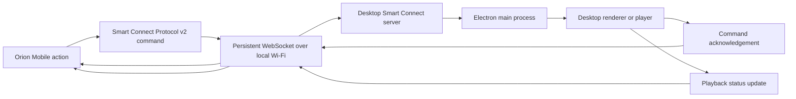
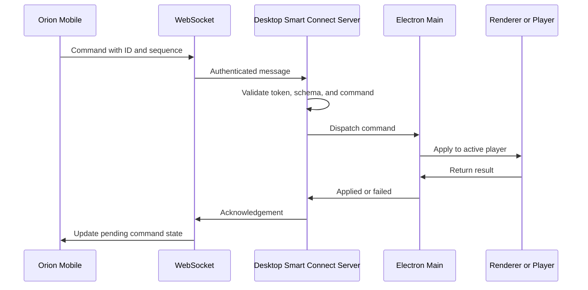
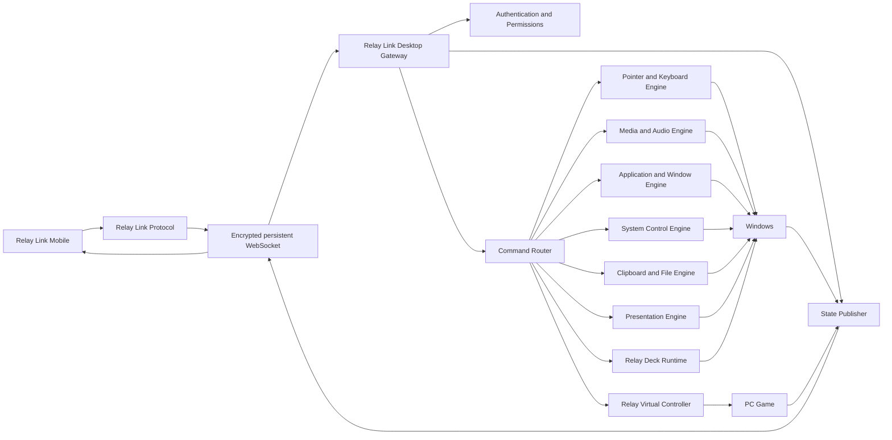

# Relay Link — Master Roadmap V2.4

**Planning correction edition: November 4, 2026.** Successor to V2.3; historical sources remain unchanged.

**PLANNING ONLY. Implementation 0%. Phase 0–13 not started.** This assignment authorizes documentation revisions, not application code, prototypes, dependencies, live workspace/Git initialization, repository creation or publishing. No product tests have run. Current explicit user instructions and [AGENTS.md](../../governance/AGENTS.md) govern authorized actions.

The owner requested corrections R01–R24 and added Emergency Gaming Disconnect Protection (EGD). Preserve the 14 phases, weights, release progression, platforms and architecture. Requirements are planned, not implemented. Exact artwork and provisional engineering budgets are not finalized by this edition.

Companions: [correction register](RELAY_LINK_V2_4_CORRECTION_REGISTER.md), [readiness](RELAY_LINK_V2_4_PHASE_0_READINESS.md), [design decisions](RELAY_LINK_V2_4_DESIGN_DECISIONS.md), [validation plan](RELAY_LINK_V2_4_VALIDATION_PLAN.md). This master consolidates earlier amendments; they are not competing options. Historical editions/reviews remain unchanged. Missing earlier files are not necessary to read this edition.

## Master Product, Tauri Desktop, Mobile, Architecture, Security, Windows Control, Relay Decks, Relay Pad, and Public-Release Roadmap

**Project name:** Relay Link  
**Mobile application:** Relay Link Mobile  
**Desktop companion:** Relay Link Desktop  
**Shared protocol:** Relay Link Protocol  
**Gaming subsystem:** Relay Pad  
**Custom control surfaces:** Relay Decks  
**Primary platform:** Windows Desktop + Android Mobile  
**Mobile frontend:** React Native + Expo Development Build + TypeScript  
**Desktop frontend:** Tauri 2 + React + TypeScript + Vite  
**Native Desktop core:** Rust with Windows-specific control modules  
**Workspace:** Production monorepo with shared schemas, design tokens, tests, installers, and release tooling  
**Architecture:** Local-first Mobile-to-Desktop control system  
**Reference foundation:** Orion Connect / Smart Connect Protocol v2  
**Proposed Relay Link protocol version:** `v1`  
**Orion Connect reference port:** `8924`  
**Relay Link port:** Dedicated and configurable; proposed default `8934` pending implementation validation  

> **Product statement:** Relay Link is a secure local-first system that turns a mobile phone into a touchpad, keyboard, media console, application launcher, window manager, presentation remote, customizable control deck, and gaming controller for a Windows computer.

> **Core rule:** Preserve the reported Orion pairing lifecycle after frozen-source provenance/parity verification. Do not replace a proven subsystem with a speculative redesign. Generalize it carefully, isolate Relay Link credentials from Orion, and harden security in controlled phases.

---

## Table of Contents

1. Product Vision
2. Product Family and Terminology
3. Project Goals
4. Scope and Non-Goals
5. Core Architectural Decisions
6. Relationship to Orion Connect
7. Orion Connect Reference Architecture to Reuse
8. Relay Link Target Architecture
9. Networking and OSI Classification
10. Relay Link Protocol Design
11. Connection, Pairing, Trust, and Reconnection
12. Command Delivery and Acknowledgements
13. Desktop State Synchronization
14. Windows Control Engines
15. Relay Link Feature Set
16. Relay Decks
17. Relay Pad Gaming System
18. Mobile UI and UX
19. Desktop UI and UX
20. Settings and Permissions
21. Security Model and Threat Boundaries
22. Performance and Latency Targets
23. Reliability and Failure Handling
24. Production Repository and Workspace Structure
25. Testing, Evidence, and Codex Verification Strategy
26. Development Phases
27. Release Version and Percentage Plan
28. Risk Register
29. Documentation Requirements
30. Definition of Done
31. Final Product Position

---

# 1. Product Vision

## Product Experience Charter (applies to every relevant phase)

Relay Link is a complete, customizable Windows + Android control experience, not a bare controller. Its core promise is **phone-first operation of normal Windows tasks and compatible PC games without routinely touching a physical mouse, keyboard or gamepad after initial setup**. There are real platform boundaries: Windows sign-in and secure approval screens, some protected applications, unsupported anti-cheat games, and recovery situations may need local interaction. Relay Link must explain these limits rather than claim universal compatibility.

**Universal experience:** genre/activity controls, Phone Tilt and Steering Wheel, distinctive readable typography, coordinated Desktop/Mobile design and an abstract letter-free link symbol. These are planned requirements; named games in historical editions are style illustrations, never compatibility claims.

**Experience pillars**

1. **Complete control:** Desktop navigation, accurate mouse/touchpad and keyboard, apps, windows, sound, media, system functions, and relevant in-session tools, with permissions and confirmations for sensitive actions.
2. **Game diversity:** Distinct profiles for native-controller games, keyboard/mouse games, and compatible hybrid games; genre templates for action, shooter, racing, fighting, platformer, strategy, rhythm, flight/simulation and emulators. Game-specific support is validated and honestly labeled.
3. **Stay in control:** Every gaming layout keeps an always-accessible, non-obstructive route to the phone-based PC Remote. A user can handle launchers, popups, windows and game exit, then return to gameplay without using physical peripherals in supported scenarios.
4. **Deep but discoverable customization:** Desktop and Mobile each have a comprehensive settings experience, searchable categories, clear previews, safe defaults, per-game profiles, reset granularity, and only contextual advanced settings when needed.
5. **One coordinated product:** Relay Command Center on Desktop and the Mobile Home share names, states, status explanations and visual DNA, while retaining platform-specific controls. Preference synchronization must be explicit, permission-aware and conflict-safe.
6. **Premium but lightweight:** Beautiful layout, typography, restrained depth, purposeful motion and immediate feedback, with adaptive low-resource operation and no performance penalties from decorative effects during active control or gaming.
7. **User-respecting trust:** Clear pairing, access visibility, emergency stop, honest error messaging and privacy-by-default. Never bury essential controls or warnings.

**Default experience:** A first-time user can pair, navigate Windows, use media, launch an application and customize essential settings without any documentation or command-line tool. Game controls become available by milestone; an unshipped feature must be clearly marked as planned, never shown as working.


Relay Link should not be treated as a small remote-control utility. It is a local device-control platform connecting Mobile and Windows Desktop through a fast, persistent, authenticated channel.

The phone becomes a purpose-built command surface for the computer. It should remain useful even when full desktop screen streaming is disabled.

Relay Link should provide three levels of control:

1. **Universal desktop control**
   - Mouse
   - Keyboard
   - Media
   - Applications
   - Windows
   - System functions

2. **Purpose-built control surfaces**
   - Presentation remote
   - Media console
   - Developer deck
   - Editing deck
   - Custom user-created decks

3. **Gaming control**
   - Keyboard and mouse game layouts
   - Xbox-style virtual controller
   - Motion controls
   - Haptic feedback
   - Local multiplayer using multiple phones

The product should feel like a pocket command console rather than a miniature copy of the Desktop screen.

---

# 2. Product Family and Terminology

## 2.1 Relay Link

The complete product and ecosystem.

## 2.2 Relay Link Mobile

The Android application used to discover, pair with, control, and receive state from Windows computers.

## 2.3 Relay Link Desktop

The Windows companion responsible for:

- Hosting the local connection server
- Pairing and authenticating devices
- Executing approved commands
- Reporting system state
- Managing paired devices and permissions
- Hosting Relay Deck definitions
- Connecting to the virtual game-controller layer

## 2.4 Relay Link Protocol

The shared application-layer contract used by Relay Link Mobile and Relay Link Desktop.

It is derived from Smart Connect Protocol v2 but must have its own:

- Protocol name
- Version namespace
- Message schemas
- Service identifier
- Tokens
- storage keys
- permission model
- port configuration

## 2.5 Relay Decks

Customizable control surfaces composed of buttons, sliders, dials, touch areas, shortcuts, application actions, and approved scripts.

## 2.6 Relay Pad

The gaming subsystem that turns a phone into a Windows game controller.

## 2.7 Relay Virtual Controller

The Windows-side component that exposes a virtual gamepad to Windows and games.

---

# 3. Project Goals

## 3.1 Primary Goals

- Preserve the reported Orion pairing/connection behavior after provenance and parity verification.
- Provide low-latency control over a trusted local network.
- Make normal desktop control useful without screen streaming.
- Build a permission-aware system instead of granting every phone full control.
- Keep Mobile and Desktop state synchronized.
- Support reliable acknowledgements for discrete actions.
- Support high-frequency state streaming for touchpads, sticks, triggers, and motion controls.
- Make security a release gate, not a cosmetic setting.
- Build in clear phases so each capability can be completed and tested before the next begins.

## 3.2 Long-Term Goals

- Full customizable Relay Deck ecosystem
- Virtual Xbox-style controller support
- Multiple phone controllers for local multiplayer
- Low-frame-rate desktop preview
- Full remote desktop streaming
- Optional end-to-end encrypted internet relay
- Cross-platform Desktop support after Windows reaches maturity

---

# 4. Scope and Non-Goals

## 4.1 Initial Scope

The first stable product should support:

- One Windows computer
- One or more paired Android phones
- Local Wi-Fi or Ethernet network
- Secure pairing
- Persistent authenticated connection
- Touchpad
- Keyboard
- Media controls
- Basic system controls
- Application launching
- Window management
- Desktop state synchronization

## 4.2 Deferred Scope

The following should not block the first stable release:

- Full screen streaming
- Internet-based control
- macOS support
- Linux support
- iOS support
- Cloud account dependency
- Community deck marketplace
- Advanced scripting marketplace
- Driver-level controller emulation before the core remote is stable

## 4.3 Explicit Non-Goals for Early Releases

- Exposing Relay Link directly to the public internet
- Sharing Orion Connect authentication tokens
- Using Google authentication as the command transport
- Building uncontrolled macro or cheating automation for games
- Silently granting administrative access
- Replaying dangerous commands automatically after reconnection

---

# 5. Core Architectural Decisions

## 5.1 Local-First by Default

Commands travel directly between Mobile and Desktop over the local network. No cloud database or Google service is required for normal control.

## 5.2 Orion Pairing Is the Baseline

The reported Orion lifecycle should be behaviorally preserved after source/provenance verification:

- Desktop local server
- Six-digit temporary pairing code
- Five-minute expiry
- QR code containing local endpoint and temporary code
- `/api/pair` exchange
- Cryptographically random persistent token
- Secure storage on both devices
- Automatic reconnection using the saved token
- Device revocation
- Brute-force limits
- Token inactivity expiry

Relay Link should adapt this mechanism rather than inventing a completely different pairing system in Phase 1.

## 5.3 Separate Product Identity

Relay Link must not accidentally become another client of Orion's exact production service.

It must have separate:

- Service discovery name
- Protocol identifier
- Protocol version
- application ID
- storage namespace
- device registry
- pairing tokens
- port or port-selection rules
- desktop permissions

## 5.4 Persistent Realtime Channel

Use a persistent WebSocket as the primary application messaging channel.

Use authenticated HTTP for:

- Pairing
- Initial status
- Recovery
- Diagnostics
- Carefully controlled command fallback

## 5.5 Native Windows Execution Layer and Final Desktop Stack

Relay Link Desktop will **not use Electron**.

The approved Desktop stack is:

```text
Tauri 2 shell
    + React
    + TypeScript
    + Vite
    + Rust command/core layer
    + Windows-specific native modules
    + optional Windows service only where required
    + separate virtual-controller driver for Relay Pad
```

The Desktop React frontend is a control center and configuration interface. It must not directly execute unrestricted Windows actions.

```text
React Desktop UI
        ↓
Tauri capability and command boundary
        ↓
Relay Link Rust Core
        ↓
Permission and safety policy
        ↓
Windows Control Modules / Service / Driver
```

The native layer owns:

- Mouse and keyboard injection
- Foreground application and game detection
- Window and monitor management
- Media sessions and audio controls
- Clipboard and approved file operations
- Power and system commands
- Relay Pad state delivery
- Virtual-controller communication
- Diagnostics and health reporting

Registered custom Tauri application commands require explicit application-command manifest/permissions; plugin capability files alone must not be assumed to constrain them. Enumerate commands, grant narrow scopes to actual windows/webviews and test undeclared/forbidden calls. Same-webview routes share authority; route names are not security principals. Rust independently checks caller/device/session, capability, target, arguments, replay/deduplication and safety on LAN, HTTP and local UI paths. Host-local administration cannot be confused with a phone requesting new authority. Remote origins receive no native grants by default. Phase 0 tests harmless boundary fixtures; Windows control stays disabled until Phase 2 passes.

## 5.6 Permission-First Design

Every paired phone should have explicit capabilities such as:

- Pointer
- Keyboard
- Media
- Windows
- Applications
- Clipboard
- Files
- System power
- Scripts
- Game controller
- Screen viewing

Permissions are enforced in the Desktop core, not only hidden or disabled in the frontend.

## 5.7 Two Communication Patterns

Relay Link must support both:

1. **Reliable discrete commands**
   - Launch application
   - Lock computer
   - Click
   - Key shortcut
   - Change mode

2. **High-frequency latest-state streams**
   - Pointer movement
   - Scroll movement
   - Analog sticks
   - Triggers
   - Gyroscope

These should not be forced into identical acknowledgement behavior.

## 5.8 Frontend Platform Decision

### Relay Link Mobile

Use:

- React Native
- Expo Development Build rather than Expo Go-only development
- TypeScript
- Expo Router
- React Native Gesture Handler
- React Native Reanimated
- Expo SecureStore
- Native haptics and sensor modules
- A non-React realtime input buffer for Relay Pad

React owns the screen structure and user state. Joystick, touchpad, gyro, and trigger sampling must not rerender the complete React tree at 60 or 120 Hz.

### Relay Link Desktop

Use:

- Tauri 2
- React
- TypeScript
- Vite
- Rust commands and services
- CSS Modules or an equivalent scoped styling method
- Shared semantic design tokens
- Accessible headless primitives where appropriate

The Desktop app should feel like a native system companion, not a browser page placed inside a window.

### Shared Frontend Foundation

Mobile and Desktop share:

- Protocol schemas
- Error codes
- Permission definitions
- Device models
- Controller-profile schemas
- Deck schemas
- Localization keys
- Semantic design tokens
- Connection-state names

They should not be forced to share every visual component. A Mobile game controller and a Desktop settings dashboard have different ergonomic requirements.

## 5.9 Public-Product Standard

Relay Link is being built for public use, not for one developer machine.

Every implementation decision must account for:

- Clean installation on supported Windows systems
- No hardcoded user paths or local IP assumptions
- Guided onboarding
- Automatic dependency handling
- Firewall and network guidance
- Compatibility across displays, DPI scaling, phones, routers, and network adapters
- Safe update and rollback behavior
- Diagnostics and self-repair
- Accessibility
- Privacy and local-first defaults
- Clean uninstall and user-data deletion
- Signed production artifacts where required

The product-level question is:

> Can a normal supported user install Relay Link, pair a phone, understand permissions, and control the computer without developer knowledge?


---

# 6. Relationship to Orion Connect

Orion Connect is a media-specific local control and playback synchronization system.

Relay Link is a system-wide Windows control platform.

The projects are related but must remain separate products.

| Area | Orion Connect | Relay Link |
|---|---|---|
| Primary purpose | Control Orion playback | Control the entire Windows Desktop |
| Mobile role | Orion companion | System remote and game controller |
| Desktop role | Orion Smart Connect server | Relay Link Desktop agent |
| Pairing | Six-digit code and token | Reuse and generalize Orion mechanism |
| Realtime channel | WebSocket | Encrypted WebSocket target |
| HTTP | Pairing and fallback | Pairing, diagnostics, recovery, controlled fallback |
| Commands | Playback and Orion pointer actions | Mouse, keyboard, media, apps, windows, system, files, games |
| State | Playback status | System, app, window, media, transfer, controller state |
| Permissions | Basic paired-device trust | Fine-grained per-device capabilities |
| Security scope | Trusted home network baseline | Whole-system control requires stronger hardening |

## 6.1 Reference provenance and authorized access

During Phase 0 freeze an owner-authorized Orion source revision and record logical Desktop/Mobile/protocol paths, rights/license assessment, behavior and parity plan in `docs/orion-reference/`. No revision, reuse rights or source behavior was independently verified in this planning round. Do not modify Orion or depend on a local absolute path.

Historical logical references: `apps/desktop/src/main/ipc/smartConnectIpc.js`, `apps/mobile/src/features/connect/useConnectController.ts`, `packages/shared/src/types/smartConnect.ts`. Verify at the frozen revision. Missing access blocks source reuse/parity, not unrelated foundation documentation.

---

## 6.2 Reuse Strategy

Do not copy the code blindly into Relay Link.

Use this sequence:

1. Document the current Orion behavior with tests.
2. Identify connection logic that is product-neutral.
3. Copy or extract only that stable behavior.
4. Rename protocol and storage namespaces.
5. Replace Orion-specific playback commands with capability-based Relay Link commands.
6. Add compatibility tests to prove pairing still works.
7. Harden security without changing several variables at once.

## 6.3 What Must Not Be Shared

Relay Link and Orion Connect must never share:

- Persistent bearer tokens
- Device approval records
- Revocation records
- Service discovery identity
- Command namespace
- permissions
- connection status

A phone paired with Orion must not automatically gain Relay Link control over Windows.

---

# 7. Orion Connect Reference Architecture to Reuse

This is the reported historical Orion baseline from V2.3, not independently verified code or Relay Link security acceptance. Establish provenance in Phase 0 and parity in Phase 1. Plaintext transport and historical dead-connection timing are not production control-safety defaults.

## 7.1 Current Orion Technologies

- Desktop server: Node.js HTTP server inside Electron
- Live channel: WebSocket using the `ws` package
- Mobile client: React Native WebSocket client
- Pairing methods: QR, automatic LAN discovery, direct IP
- Temporary credential: six-digit pairing code
- Persistent credential: cryptographically random 32-byte token
- Desktop secure storage: Electron `safeStorage`
- Mobile secure storage: Expo SecureStore
- Shared contract: Smart Connect Protocol v2
- Default Orion port: `8924`

## 7.2 Current High-Level Flow



Relay Link should preserve this general pattern while replacing the Orion renderer/player with the Windows control agent and multiple capability engines.

## 7.3 Orion Server Startup

1. Orion Desktop starts an HTTP server on the local network.
2. The server listens on the configured interface and port.
3. Mobile can reach an endpoint such as:

```text
http://192.0.2.10:8924
```

4. Desktop exposes protocol identity and status endpoints.
5. Desktop opens the WebSocket upgrade path for authenticated devices.

## 7.4 Orion Discovery Methods

### QR Discovery

The Desktop QR code contains:

- Desktop local IP
- Port
- Temporary pairing code
- Protocol identity

### Automatic LAN Discovery

When a saved IP fails, Mobile:

1. Reads its Wi-Fi IP.
2. Determines the local `/24` subnet.
3. Probes candidate addresses in batches of 24.
4. Looks for a server identifying Smart Connect Protocol v2.
5. Saves the last working Desktop IP.

### Direct IP

The user can manually enter a local address when QR or discovery is unavailable.

### Relay Link Improvement

Relay Link should add mDNS or NSD as the primary discovery method and keep bounded subnet probing as fallback.

## 7.5 Orion Pairing Flow

1. Desktop generates a random six-digit code.
2. The code expires after five minutes.
3. Desktop displays the code and QR.
4. Mobile sends the code and device identity to `/api/pair`.
5. Desktop validates the code and rate limits.
6. Desktop generates a random 32-byte persistent token.
7. Desktop stores the paired-device record securely.
8. Mobile stores the token in secure mobile storage.
9. Future connections use the token, so normal use does not require repeated pairing.

## 7.6 Existing Pairing Protections

- Five failed attempts per minute
- Two-minute temporary lockout
- Pairing-code expiry
- Previously paired token expiry after 90 days of inactivity
- Individual device revocation

Relay Link should preserve all of these in its first pairing implementation.

## 7.7 Orion Reconnection Flow

1. Mobile attempts the last successful Desktop endpoint.
2. It presents the stored token.
3. Desktop validates the token and device record.
4. The authenticated WebSocket opens.
5. Desktop sends current state.
6. Mobile returns to the connected UI without pairing again.

Re-pairing is required after token expiry, revocation, secure-storage loss, Desktop reset, or cryptographic identity change.

## 7.8 Orion Command Envelope

```json
{
  "id": "mobile-device-1753950000000-42",
  "sequence": 42,
  "action": "play_pause",
  "sentAt": 1753950000000
}
```

Pointer movement uses normalized coordinates:

```json
{
  "action": "cursor_move",
  "pointer": {
    "x": 0.54,
    "y": 0.31
  }
}
```

Normalized values from `0` to `1` make a touch surface independent of Desktop resolution.

## 7.9 Orion Command Lifecycle



## 7.10 Orion Acknowledgement

```json
{
  "id": "command-id",
  "sequence": 42,
  "ok": true,
  "appliedAt": 1753950000048
}
```

This reported Orion acknowledgement indicates application processing, not independent evidence of an observed game/Windows effect. TCP delivery alone proves neither. Relay Link reports dispatch/application result separately from observed effects, especially game pause.

## 7.11 Orion Timing Behavior

- Desktop command timeout: 1.8 seconds
- Mobile acknowledgement timeout: 2.2 seconds
- Heartbeat interval: 15 seconds
- Dead connection detection: approximately 45 seconds
- Automatic reconnection attempt: after 1.8 seconds
- HTTP status safety poll: every 1.5 seconds
- Pointer update throttle: approximately 30 updates per second, one every 33 ms

Relay Link may use different timing per command category, but these are reported reference values, not verified Relay Link budgets.

## 7.12 Orion HTTP Fallback

When WebSocket delivery fails, Orion can retry through authenticated HTTP.

Benefits:

- Recovery during a broken WebSocket
- Better reliability for discrete commands
- Easier diagnostics

Risk:

A late WebSocket command and an HTTP retry may both execute. Toggle commands such as `play_pause` can reverse themselves if applied twice.

Required Relay Link rule:

> Every retryable command must use a stable command ID, and Desktop must deduplicate IDs before execution.

## 7.13 Orion Connection Health

- Heartbeat every 15 seconds
- Dead connection detection near 45 seconds
- Reconnect after approximately 1.8 seconds
- HTTP safety polling every 1.5 seconds
- Playback status pushed over WebSocket

## 7.14 Orion State Synchronization

Desktop sends:

- Active title
- Media type
- Duration
- Current position
- Paused state

Mobile uses this for the title, playback controls, timeline, and remote HUD.

Relay Link should generalize the same push model into capability-specific snapshots.

## 7.15 Orion Responsiveness Principles

- Direct LAN communication
- Persistent WebSocket
- Small messages
- Immediate Desktop dispatch
- Controlled pointer rate
- Real application acknowledgements
- No cloud round trip

## 7.16 Orion Security Limitation

The current Orion transport uses `http://` and `ws://`.

Commands are authenticated, but transport is not encrypted. On an untrusted network, a captured token may be reusable.

Relay Link controls the entire computer, so it cannot stop at this security level for a stable public release.

Target hardening:

- WSS or equivalent authenticated encrypted transport
- No reusable token in URLs
- Device-bound keys
- Key rotation and re-pairing
- Replay protection
- Duplicate-command prevention
- Safer interface binding
- Firewall guidance
- Rate limits
- Hostile-network tests

---

# 8. Relay Link Target Architecture

## 8.1 High-Level Architecture



## 8.2 Relay Link Mobile Responsibilities

- Discovery
- QR scanning
- Pairing
- Secure credential storage
- Connection state
- Remote UI
- Touchpad gestures
- Keyboard entry
- Control decks
- Gamepad rendering
- Sensor sampling
- Haptic feedback
- Pending command state
- Error presentation
- Reconnection

## 8.3 Relay Link Desktop Gateway

- HTTP and WebSocket server
- Protocol-version validation
- Authentication
- Device registry
- Permission checks
- Rate limiting
- Command routing
- Deduplication
- State publication
- Heartbeats
- Diagnostics

## 8.4 Native Windows Control Agent

- Mouse injection
- Keyboard injection
- Media keys
- Audio control
- Application launching
- Window enumeration and management
- Monitor information
- Clipboard access
- File operations
- Screenshot capture
- System status
- Lock, sleep, restart, and shutdown handling

## 8.5 Optional Windows Service

Use a user-session host by default. Close to tray may keep that process running without a privileged service; explicit Quit stops authority and releases owned input. Host crashes need an independent applicable input/driver fail-safe.

Only introduce a narrowly scoped service after an approved requirement/threat model shows user-session operation is insufficient. Authenticate IPC and constrain operations. No universal privileged command tunnel. Windows sign-in, UAC/secure desktop and protected screens remain outside the normal phone-control promise; never claim protection bypass.

---

## 8.6 Relay Virtual Controller

A separate component should translate Relay Pad state into a virtual Windows game controller.

This component requires its own technical spike, installation plan, signing plan, recovery behavior, diagnostics, and uninstall path.

---

## 8.7 Tauri Desktop Application Architecture

Relay Link Desktop is both a background connection host and a visible product control center.

### Desktop Process Responsibilities

```text
Tauri Window Layer
├── Dashboard and onboarding
├── Pairing and devices
├── Permissions and security
├── Relay Deck and Relay Pad configuration
├── Transfers, activity, diagnostics, and updates
└── Settings and appearance

Rust Core Layer
├── LAN server and protocol session
├── Authentication and authorization
├── Command routing and deduplication
├── State collection and event publishing
├── Diagnostics and update coordination
└── Safe bridge to Windows modules

Windows Modules
├── Input
├── Media and audio
├── Applications and windows
├── Clipboard and files
├── System controls
├── Game detection
└── Virtual controller
```

### Desktop Window Model

Use one primary settings/dashboard window, with optional focused windows only where they improve safety or usability:

- Pairing approval dialog
- Destructive-action confirmation
- Update progress
- Driver installation or repair
- Diagnostic export

Avoid creating many independent windows with overlapping authority.

### Background Behavior

Relay Link Desktop should support:

- Start at login, optional and user-controlled
- Minimize or close to tray
- User-session LAN host remains alive when the window is intentionally closed to tray
- Pause remote control without quitting
- Visible tray status
- Safe shutdown of sessions on application exit
- Optional Windows service only for capabilities that cannot reliably run in the user session

### Tauri Capability Policy

Apply §5.5 explicit application-command permissions, narrow actual webview/window grants and Rust authorization. A pairing approval window cannot invoke power/files; a genuinely separate activity webview is read-only; driver management invokes only approved signed installer/repair operations. Same-webview routes are not isolated principals. Test wildcard/overlapping grants, forbidden direct calls and remote origins; a working UI flow alone does not prove isolation.

---

# 9. Networking and OSI Classification

Relay Link is primarily an Application Layer architecture.

| OSI layer | Relay Link mapping |
|---:|---|
| 7 Application | Relay Link Protocol, pairing, permissions, commands, acknowledgements, Decks, Relay Pad state |
| 6 Presentation | JSON or binary encoding, schema validation, timestamps, encryption representation |
| 5 Session | Authenticated WebSocket, heartbeat, reconnect, session restoration |
| 4 Transport | TCP beneath WebSocket and HTTP |
| 3 Network | IPv4 local addressing and routing |
| 2 Data Link | Wi-Fi or Ethernet frames |
| 1 Physical | Radio, electrical, or optical signaling |

Precise description:

> Relay Link is a LAN-based Application Layer device-control and realtime synchronization protocol running over WebSocket and HTTP, using TCP/IP over Wi-Fi or Ethernet.

WebSocket is the primary application messaging channel. TCP is the actual transport-layer protocol.

---

# 10. Relay Link Protocol Design

## 10.1 Protocol Identity

Proposed identity response:

```json
{
  "service": "relay-link",
  "protocol": "relay-link-v1",
  "deviceName": "Sample PC",
  "platform": "windows",
  "pairingAvailable": true,
  "capabilities": [
    "pointer",
    "keyboard",
    "media",
    "applications",
    "windows",
    "system",
    "relay-pad"
  ]
}
```

## 10.2 Standard Command Envelope

```json
{
  "type": "command",
  "id": "phone-01-8842",
  "sequence": 8842,
  "category": "window",
  "action": "focus",
  "payload": {
    "windowId": "win-739"
  },
  "sentAt": 1785963600000,
  "protocolVersion": 1
}
```

## 10.3 Acknowledgement Envelope

```json
{
  "type": "ack",
  "id": "phone-01-8842",
  "sequence": 8842,
  "ok": true,
  "status": "applied",
  "receivedAt": 1785963600011,
  "appliedAt": 1785963600019
}
```

## 10.4 Failure Envelope

```json
{
  "type": "ack",
  "id": "phone-01-8842",
  "sequence": 8842,
  "ok": false,
  "status": "rejected",
  "error": {
    "code": "PERMISSION_DENIED",
    "message": "Power controls are disabled for this device."
  }
}
```

## 10.5 Command Categories

- `pointer`
- `keyboard`
- `media`
- `audio`
- `application`
- `window`
- `monitor`
- `system`
- `clipboard`
- `file`
- `presentation`
- `deck`
- `gamepad`
- `screen`
- `diagnostic`

## 10.6 State Event Envelope

```json
{
  "type": "state",
  "topic": "active-window",
  "revision": 291,
  "capturedAt": 1785963600040,
  "payload": {
    "windowId": "win-739",
    "application": "PowerPoint",
    "title": "Project Review"
  }
}
```

## 10.7 Protocol Versioning

- Every connection declares supported protocol versions.
- Desktop selects the highest mutually supported version.
- Missing required fields, invalid values and unsupported required features reject with stable errors. Unknown optional fields are tolerated only within documented bounds and cannot grant authority.
- New optional fields must not break older clients.
- Breaking changes require a new protocol major version.

## 10.8 Idempotency and Deduplication

Desktop should cache recently applied command IDs per device.

For a duplicate:

- Do not execute again.
- Return the original result when available.
- Record the duplicate for diagnostics.

## 10.9 Sequence Validation

Sequence numbers should:

- Increase per device session
- Detect stale or replayed commands
- Help diagnose ordering issues
- Be reset only through an authenticated session reset

## 10.9a Session and retry boundaries

Bind device identity, fresh authenticated epoch and monotonic per-stream sequences; reject stale epochs/mode revisions. Reserve in-flight operation IDs before execution to deduplicate concurrent HTTP/WebSocket arrivals; keep bounded original outcomes. Persist protection where needed or fail closed with outcome unknown after restart. A crash after apply can lose confirmation; do not promise universal exactly-once execution. Never automatically replay dangerous commands.

Bound payloads/queues and prioritize release/input over bulk transfers and decorative telemetry. Use state revisions/full snapshots on gaps; wall clocks across devices alone cannot establish event order/latency. EGD pause has a separate no-retry episode latch, not generic HTTP fallback.

## 10.10 JSON Versus Binary

Use JSON first for:

- Pairing
- Discrete commands
- State snapshots
- Errors
- Diagnostics

Use a compact binary representation later for:

- 60 Hz or 120 Hz gamepad state
- High-rate pointer streams
- Gyroscope samples
- Future media frames

---

# 11. Connection, Pairing, Trust, and Reconnection

## 11.1 Pairing Must Preserve the Orion Behavioral Baseline

Relay Link Phase 1 should preserve:

- Six-digit temporary code
- Five-minute expiry
- QR payload
- Pair endpoint
- Device identity
- Random persistent token
- Secure storage
- Automatic reconnect
- Rate limiting
- Revocation
- Inactivity expiry

## 11.2 Relay Link Pairing Extension

After temporary-code validation, Desktop should present a permission approval screen.

Example permission profile:

```text
Device: Sample Phone

Allowed:
✓ Pointer
✓ Keyboard
✓ Media
✓ Applications
✓ Windows

Requires confirmation:
• Clipboard
• Files
• System power
• Relay Pad

Denied:
✕ Scripts
✕ Screen viewing
```

## 11.3 Pairing trust and enforceable identity gate

Preserve six-digit/five-minute pairing and lifecycle while strengthening trust. Phase 0 records bootstrap/cryptographic decisions. Phase 1 may migrate token behavior only in isolated development with Windows control disabled; never distribute reusable credentials over unverified plaintext networks.

By Phase 2 implement and test encrypted authenticated pairing/control transport, host pinning, device-bound key proof, secure private-key storage, rotatable session credentials, revocation, replay protection and identity-change re-pairing. A plan alone cannot pass. Copied bearer tokens without bound-key proof must not establish control.

Bootstrap proposal for Phase 0 security review: QR binds host-key fingerprint, service identity and temporary challenge; verify that binding in an authenticated handshake, show host/device identity and obtain Desktop capability approval. Code/manual endpoint entry needs independently checked identity comparison or an equivalently reviewed authenticated key exchange. Never trust an arbitrary first endpoint, disable certificate checks or invent ad hoc crypto. Select maintained libraries and exact algorithms/rotation in Phase 0; adversarial verification is Phase 2.

Pin mismatch, revoked key, stale challenge or secure-storage failure disables authority and offers explicit re-pairing; no silent pin replacement. Pairing rate/inactivity limits remain mandatory. Sensitive confirmation binds a specific action/target/short validity to the authenticated session; a client-side biometric-success flag cannot itself authorize a host operation. Host capability and required local approval remain authoritative.

---

## 11.4 Discovery Order

1. Last known working endpoint
2. mDNS or NSD discovery
3. QR code
4. Bounded subnet fallback
5. Direct IP entry

## 11.5 Reconnection Rules

- Preserve current screen and selected control mode.
- Require a fresh authenticated session epoch, current permissions and neutral snapshot; deliberate re-arm and fresh actions are required after safety disarm.
- Do not replay destructive commands.
- Release only Relay Link-owned keys/buttons/drags/axes/triggers and cancel Cruise; preserve saved configuration, never live held state, old packets or queued pause.
- Request a fresh state snapshot.
- Show connection quality and actual Relay Link latency.

---

# 12. Command Delivery and Acknowledgements

## 12.1 Three Acknowledgement States

| State | Meaning |
|---|---|
| `received` | Desktop accepted and validated the command |
| `applied` | Windows or the target engine successfully applied it |
| `rejected` | Permission, validation, state, or execution failure |

A Relay Link applied result must state its evidence level: host/OS API acceptance is not independent proof a game responded, input visibly released or simulation paused. Unknown/blocked target outcome must not be mislabeled success.

## 12.2 Explicit Acknowledgements Required For

- Clicks
- Keyboard shortcuts
- Application launch
- Window close
- System power actions
- Clipboard operations
- File operations
- Deck changes
- Controller mode changes
- Pairing and permission changes

## 12.3 Stream Acknowledgement Strategy

Do not acknowledge every analog or movement packet individually.

For high-frequency streams:

- Send full current state or compact deltas.
- Keep only the newest unsent state.
- Desktop reports the highest processed sequence periodically.
- Use heartbeat and stream health metrics.
- Return all inputs to neutral on disconnect.

## 12.4 HTTP Fallback Policy

HTTP fallback is allowed only for commands marked retry-safe.

Commands should declare one of:

- `idempotent`
- `deduplicated`
- `never-retry`

Examples:

| Command | Retry policy |
|---|---|
| Set volume to 40 | Idempotent |
| Focus window ID | Deduplicated |
| Toggle play/pause | Deduplicated, never sent with a new ID |
| Shut down computer | Never automatic retry |
| Send file chunk | Chunk ID deduplicated |

---

# 13. Desktop State Synchronization

Relay Link should publish topic-specific snapshots.

## 13.1 Core State Topics

- Connection health
- Desktop identity
- Active window
- Running applications
- Window list
- Monitor layout
- System volume
- Per-app audio sessions
- Active media session
- Battery and power
- CPU, memory, storage summary
- Clipboard availability
- File transfers
- Presentation session
- Relay Deck state
- Relay Pad state
- Virtual controller slots

## 13.2 State Freshness

Each state event should include:

- Capture timestamp
- Monotonic revision
- Source engine
- Optional freshness class

Mobile should visibly distinguish:

- Live
- Recently updated
- Stale
- Unavailable

## 13.3 Push First, Poll as Recovery

- WebSocket pushes immediate updates.
- HTTP polling verifies status when events appear stale.
- Polling must not become the normal source of every moving value.

---

# 14. Windows Control Engines

## 14.1 Pointer Engine

Capabilities:

- Relative movement
- Absolute normalized movement
- Left, right, and middle click
- Double click
- Drag and drop
- Vertical and horizontal scroll
- Multi-monitor coordinate mapping
- Sensitivity and acceleration
- Precision mode

## 14.2 Keyboard Engine

Capabilities:

- Text input
- Key down and key up
- Modifiers
- Function keys
- Navigation keys
- Shortcut chords
- Keyboard layouts
- Safe release of stuck modifiers

## 14.3 Media and Audio Engine

Capabilities:

- Play and pause
- Previous and next
- Seek
- System volume
- Mute
- Per-application volume
- Output-device selection
- Active media metadata

## 14.4 Application Engine

Capabilities:

- Installed favorites
- Running applications
- Recently used applications
- Launch
- Focus
- Minimize
- Close
- Force close with confirmation
- Pin to Relay Link

## 14.5 Window Engine

Capabilities:

- Enumerate top-level windows
- Active state
- Focus
- Minimize
- Maximize
- Restore
- Close
- Snap left or right
- Move to another monitor
- Move to another virtual desktop when supported

## 14.6 System Engine

Capabilities:

- Lock
- Sleep
- Restart
- Shut down
- Sign out
- Brightness
- Night light
- Do Not Disturb
- Display mode
- Screenshot
- Task Manager
- Battery and charging
- CPU, memory, and storage summary

Dangerous actions require host-enforced capability and action-bound confirmation per §11.3; UI hold/biometric success never replaces host policy or permits automatic retry.

## 14.7 Clipboard Engine

Capabilities:

- Send text to Desktop
- Pull Desktop text
- Send images
- Optional small-file clipboard
- Clipboard history
- Pin snippets
- Clear clipboard

## 14.8 File Engine

Capabilities:

- Send files to approved destination
- Browse approved Desktop folders
- Download files
- Transfer queue
- Pause and resume
- Chunk verification
- Transfer history

Desktop folder access must use allowlists.

## 14.9 Presentation Engine

Capabilities:

- Start slideshow
- End slideshow
- Next and previous slide
- Blank screen
- Laser pointer
- Timer
- Current slide number
- Speaker notes when available

---

## 14.10 Input ownership and data safety

The host records Relay Link contributions by device/session/target/slot. Shared keyboard/mouse access is arbitrated; release only owned contributions and reference-count overlaps. Physical input and unrelated-phone state must not be indiscriminately cleared. Refuse unsupported concurrent-control modes where OS isolation cannot be established.

Phase 6 specifies final path/reparse-point/race checks, resume identity, integrity, quotas, safe partial-file commit, overwrite approval and cleanup within allowlists. Clipboard direction/history is opt-in with retention and no sensitive default logs. Never use clipboard/diagnostics to bypass viewing permission for screenshot pixels.

Update design identifies signing trust roots, authorized publishers, atomic failure recovery and schema migration/rollback. Downgrade cannot restore revoked trust or live input. Decisions precede applicable implementation gates.

# 15. Relay Link Feature Set

## 15.1 Precision Touchpad

Gestures:

| Gesture | Action |
|---|---|
| One-finger movement | Move cursor |
| Single tap | Left click |
| Double tap | Double click |
| Tap and hold | Drag |
| Two-finger tap | Right click |
| Two-finger movement | Scroll |
| Three-finger swipe up | Task View |
| Three-finger swipe left or right | Change virtual desktop |
| Pinch | Configurable zoom |
| Edge swipe | Open shortcut drawer |

## 15.2 Keyboard Remote

- Standard text entry
- Ctrl, Alt, Shift, Windows modifier locks
- Escape, Tab, Delete, Backspace
- Arrow keys
- Function row
- Home, End, Page Up, Page Down
- Shortcut strip
- Saved shortcuts
- Clipboard paste

## 15.3 Media Console

- Current media
- Artwork where available
- Play and pause
- Previous and next
- Seek
- Timeline
- Volume
- Per-app volume
- Output device

## 15.4 Application Launcher

- Search
- Favorites
- Running apps
- Recent apps
- Launch and focus
- App actions sheet

## 15.5 Window Manager

- Window cards
- App icon and title
- Monitor placement
- Focus
- Minimize
- Maximize
- Restore
- Close
- Move
- Snap

## 15.6 System Console

- System status
- Audio
- Display
- Network status
- Power commands
- Screenshot
- Task Manager

## 15.7 Clipboard Bridge

- Push and pull
- History
- Pinned snippets
- Privacy indicator

## 15.8 File Transfer

- Upload and download
- Approved folders
- Queue
- Progress
- Integrity checks

## 15.9 Presentation Mode

- Slide controls
- Pointer
- Notes
- Timer
- Keep screen awake

---

# 16. Relay Decks

Relay Decks should become a signature feature.

## 16.1 Deck Components

- Button
- Toggle
- Slider
- Dial
- D-pad
- Analog stick
- Touch surface
- Text field
- Status label
- Progress indicator
- App launcher
- Shortcut group
- Approved script action

## 16.2 Built-In Decks

- Universal Remote
- Developer Deck
- Orion Deck
- Presentation Deck
- Music Deck
- Editing Deck
- Browser Deck
- System Monitor Deck

## 16.3 Deck Builder

Users can:

- Add controls
- Resize
- Reposition
- Assign actions
- Group controls
- Set icons and labels
- Create pages
- Set app activation rules
- Export and import

## 16.4 Deck Security

- One control maps to one approved action by default.
- Scripts are disabled by default; any enabled path needs an approved sandbox/strict allowlist, declared permissions and explicit host trust. Imports cannot enable scripts.
- Script decks require explicit Desktop trust.
- Imported decks display required permissions.
- Dangerous actions cannot hide confirmation requirements.

---

# 17. Relay Pad Gaming System

## 17.1 Product definition and complete journey

Relay Pad turns an approved Android phone into customizable controls for compatible Windows games. The user watches the PC screen; the phone shows controls only. From the phone: launch/select a game, choose a template or saved profile, control the game, use PC Controls for launchers/dialogs, return to saved controls and quit. Protected-screen and anti-cheat/input restrictions remain explicit. Named titles in historical plans illustrate control styles; none is a verified compatibility claim.

## 17.2 Architecture and compatibility routes

Phone multi-touch/sensors → non-React realtime buffer → authenticated bounded stream → Rust policy/ownership router → keyboard/mouse mapper or isolated virtual controller → supported game. Return rumble/haptics only to the associated phone/slot. UI stalls must not disable release/watchdog work. Profile/schema contracts remain shared across Desktop/Mobile; optimized binary encoding cannot change safety semantics.

- **Keyboard & Mouse:** initial Phase 8 route; explicit digital mappings, pointer movement and chords. No implied native gamepad or proportional pedal support.
- **Virtual Controller:** verified axes/triggers/buttons/slots through the Phase 9 chosen architecture and controller API. An arbitrary virtual HID is not evidence of XInput/Xbox-style support.
- **Hybrid:** only where a title accepts the combined routes; record mode-switch restrictions and input rejection. No universal mixed-source claim.

## 17.3 Universal template library

| Family | Required starting experience | Personalization |
|---|---|---|
| Shooter | Left movement, broad right aim zone, reachable fire/ADS/jump/reload/crouch/interact | Independent multi-touch, sprint/weapon/map/equipment, hold/toggle, optional scoped gyro, handedness |
| Racing/Driving | Equal Phone Tilt and Virtual Steering Wheel plus unified Drive Control | Calibration, response, deliberate reverse, track shape/placement, auxiliary actions, eligible aids |
| Open-World/Multi-Activity | One game profile with user-named activities | On Foot/Driving/Flying/Swimming/Building or only the activities actually mapped; direct favorites |
| Fighting | D-pad/arcade stick, 4/6 buttons and shoulders | Simultaneous presses, spacing, handedness; no hidden timed combinations |
| Sports/Gamepad | Dual sticks, face/shoulder buttons, D-pad and triggers | Sport-specific labels and supported analog/digital routes |
| Strategy/Management/Point-and-Click | Precision pointer, click, drag, scroll/zoom and shortcut shelf | Sensitivity, modifier/hold controls, mapped actions |
| Flight/Simulation | Configurable sticks/axes, throttle/rudder, camera, recenter | Motion or non-motion input, axis range/direction and detailed controls |
| Platformer/Rhythm/Arcade | Compact or large timing-sensitive action zones | Position, size, haptics and measured timing limits |
| Custom/Other | Create from controls or duplicate any template without a recognized title | Full mapping, custom activities, accessible variants, safe import/export |

Templates are starting points, not compatibility guarantees or rigid categories. Every unlisted/older title has a discoverable profile-creation path. Games can combine families and need not have a predefined activity.

## 17.4 Shooter, standard controller and accessible HUDs

Shooter: fixed/floating left movement, adjustable sprint/optional left fire; unobstructed right aim zone; mapped fire/ADS, jump/vault, reload, crouch/prone, interact, weapon/equipment/map where supported. Provide sensitivity/scoped response, inversion, acceleration/smoothing and optional gyro Off/While Aiming/Always, calibration and recenter. Move/aim/fire/action touches operate independently with reliable press/hold/drag/cancel/release. No decorative animation gates input.

Standard controller: dual sticks and clicks, D-pad, ABXY, shoulders, analog/digital triggers, View/Menu and Guide only where supported. Editable dead zones, curves, floating/fixed sticks, opacity, labels, haptics, size/position. Include accessible large-target, simplified, left-handed and non-motion variants. Prefer landscape for complex controls; honor safe areas/cutouts. Orientation/remapping preserves configuration but neutralizes unsafe held input first.

## 17.5 Relay Drive

Two equal primary steering choices:

1. **Phone Tilt:** relaxed holding-angle center, steering range/direction, sensitivity, dead zone, smoothing and one-action Recenter. Sensor faults disable unsafe motion input and offer Wheel.
2. **Virtual Steering Wheel:** reachable thumb wheel/arc with adjustable response and explicit return-to-center behavior. Arrange opposite the Drive Control; do not require the same thumb for both.

Stick/buttons remain explicitly chosen accessibility/compatibility fallbacks. Keep one left-thumb Drive Control reachable during tilt without regripping; allow customized/mirrored placement. Optional gears/clutch/handbrake/camera/boost/other actions appear only where mapped.

| Drive Control action | Command meaning |
|---|---|
| Up | Accelerate; proportional only where supported |
| Toward center | Reduce commanded throttle |
| Center | Coast, with neither accelerator nor brake |
| Down | Brake; proportional only where supported |
| Lift/cancel | Immediately release manual driving input and return to neutral; explicit Cruise is a separate visible opt-in state |
| Deliberate Reverse selection | Apply a verified title-specific reverse mapping; ordinary braking never silently requests reverse |

Compare straight vertical and gently curved tracks with the same mapping, target size and sensitivity. Evaluate reach/fatigue/regrips/misactivation, hand preference, phone size/case and both steering modes. **Neither track shape is selected.** Neutral/drive/brake states stay legible with animation off.

### Reverse safety

Never infer stopped state from elapsed time, throttle release or a button hold. Use actual stopped telemetry only where a lawful reliable source and meaning are verified for the title. Otherwise require a deliberate user-selected Reverse state/gesture, separate from braking, and explain that the user must judge whether reversing is safe. Exact gesture remains a design comparison; do not claim this enforces a vehicle-stop condition.

If a game's combined brake/reverse binding can reverse during normal braking and cannot be safely separated, disable that unsafe mapped behavior or label that driving route Limited support/Not supported. A hold timer alone cannot establish safe compatibility. Keyboard routes must be labeled digital; no universal analog promise.

## 17.6 Comfort, precision and optional driving aids

Comfort, Precision and Simulation are editable configurations; both primary steering styles remain selectable. Corner Assist, when explicitly enabled, reduces only commanded throttle as steering grows, with visible strength/status and immediate override. No road prediction, autonomous braking, counter-steer or guaranteed safe cornering. Disable where incompatible/prohibited.

Cruise deliberately holds a selected acceleration input, not vehicle speed. Require Cruise On plus one-action cancel. Cancel on brake, manual cancel, focus loss, mode/profile change, background/lock, stream expiry, disconnect, permission loss, host failure or emergency stop. Never auto-resume it. Thumb lift releases manual input; Cruise is separately explained, intentionally activated behavior.

Both aids are opt-in and off for precision/competitive profiles. They are declared noncompetitive input transforms, not disguised one-to-one mappings. Honor game rules; prohibit where disallowed. Recoil automation, enemy tracking, aimbots, auto-fire, timed combos and hidden multi-action scripts are excluded, not merely disabled by default.

## 17.7 Profiles and activity layouts

Use **Template → Game Profile → Activity Layouts**, storing executable identity/optional launcher, compatibility scope, route, orientation, mappings, sensitivity/dead zones, calibration, haptics and slot preferences. Desktop offers a larger visual editor; Mobile offers in-session Customize Controls, drag/resize/reposition/hide/remap. Include Reset This Control, Reset Layout, Duplicate, Restore Defaults and safe import/export. Editing a game profile never changes the original template.

Manual favorites directly select a mapped activity in one action; extra activities can use a picker. PC Controls remains reachable in every layout. Before mode/profile/editor changes release old owned inputs, cancel Cruise, advance mode revision and reject delayed old-layout packets. Preserve configuration, not pressed state. Returning from PC Controls needs current authority/target and fresh intentional input.

Foreground game detection does not establish On Foot/Driving/Flying activity. Optional activity suggestions/auto-switch require title-specific verified recognition, opt-in and manual override. Manual selection is first-class without recognition. Sync conflicts and migrations follow §20.1a; never restore authority or live input from a profile.

## 17.8 Ownership, timing and fail-safe

60 Hz standard, 30 Hz saving, optional measured 120 Hz. Use bounded latest-state queues, processed-sequence feedback and full neutral snapshots at synchronization boundaries; deltas cannot retain stale holds. Bind state to device, authenticated epoch, mode revision, game session and slot.

Maintain a dedicated input watchdog independent of the historical Orion heartbeat. **Provisional ceiling: issue neutralization within 250 ms of the last valid active input frame; initiate immediately on explicit cancellation or authoritative failure.** Measure timer jitter, release dispatch and observed neutral state. Budget changes require review before the affected gate; mandatory fail-safe protection cannot be deferred or disabled for performance.

On focus loss, invalid/revoked authority, expired stream, disconnect, background/lock, profile change or emergency stop: reject old-epoch input, cancel assists and release only that session's Relay Link-owned keys/buttons/drags/axes/triggers/motion contributions. Reference-count shared mapped contributions where appropriate; do not indiscriminately clear physical/other-phone state. Refuse unsupported concurrent keyboard/mouse control if isolation cannot be established. Phase 9 needs independent controller/driver timeout on host death; a dead host cannot perform cleanup.

## 17.9 Motion, haptics and resource behavior

Immediate local feedback is distinct from a Windows-applied confirmation. Route rumble to its correct phone/slot; adjustable strength/off and battery-saving behavior. Motion covers steering, aim/camera/flight, smoothing, inversion, calibration and recenter. Finished motion is Phase 10; early hooks do not establish compatibility. Realtime buffers stay outside React render frequency; suspend decorative backgrounds and unnecessary work while gaming/minimized.

## 17.10 Compatibility evidence

Labels: Verified compatible / Limited support / Not verified / Not supported, scoped to game/version/platform, route, profile, build/date and restrictions. Record launch, menus, simultaneous actions, pause, PC Controls return, mode switching, disconnect/reconnect and exit. Cover diverse eligible titles including older/unlisted/custom examples. No anti-cheat bypass, memory inspection or game-process injection. Process detection/template availability does not prove input acceptance. An online menu is not evidence gameplay paused.

## 17.11 Detection and activation

Use host-local executable/application/window identity and optional approved launcher metadata with debounce/exclusions/manual override. Events travel over the authenticated session; do not imply an additional signature design before it is specified and implemented. Keep detection local; log redacted identity/result, not gameplay content.

| Mode | Exact behavior |
|---|---|
| Manual | Suggest; user opens assigned controls |
| Ask Every Time | Explicit confirmation for each activation |
| Auto for Trusted Games | Prior explicit game/profile opt-in plus visible cancelable countdown may activate without another tap; no new authority |
| Never Auto-Switch | No detection-driven transition; manual navigation only |

Never bypass lock/biometric policy, current host permission, driver consent or safety. Alt+Tab grace affects presentation only; focus loss neutralizes input immediately. Display restoration never restores holds. A different process instance/game creates a new target-bound session.

## 17.12 Local multiplayer

Each phone owns its epoch/slot/profile and battery/latency record. Host can pause/reassign/remove players; slot changes cannot reuse stale input. Use exclusive keyboard/mouse arbitration when the platform cannot isolate players. Release is scoped to the lost controller. Game-wide pause can affect other players and requires an explicit shared-game policy; unrelated sessions must never receive release or pause actions.

## 17.13 Competitive integrity and host safety

Competitive Safe Mode enforces declared one-action mappings and excludes unfair automation. Optional noncompetitive aids follow §17.6. EGD is a disclosed, narrow host cleanup policy, not an imported macro/script or additional phone authority. It honors game restrictions and can disable pause for incompatible routes; release protection remains mandatory.

## 17.14 Emergency Gaming Disconnect Protection — critical requirement EGD

### EGD-01 Detection and release priority

Classify **intentional end**, **suspected brief interruption**, and **confirmed unexpected loss** separately. Intentional end requires an authenticated session command or host-local action before closure; an unreceived/racing intent cannot be assumed delivered. On intentional end release owned input and show ended; automatic emergency pause is off by default. Explicit manual pause-on-exit is a separate action.

For suspected gaps, release on input expiry without waiting for loss confirmation. Explicit transport failure initiates release immediately. Provisional unexpected-loss confirmation: **750 ms since last valid session liveness evidence, or authoritative transport failure sooner**. A brief interruption has no automatic pause until confirmed. The 250 ms input ceiling still applies independently. No animation, pause acknowledgement or 45-second heartbeat may delay release. Gaming-session liveness must attest to a healthy active control route; unrelated UI/socket traffic cannot keep a failed gaming route alive or reset its loss timer.

Recovery after safety expiry always requires a fresh authenticated epoch, neutral state and deliberate re-arm/fresh input, even if a brief interruption clears. Old packets cannot renew an expired session. Ambiguous intent is unexpected with conservative target guards, not a reason to retain input.

### EGD-02 One configurable pause attempt

For a confirmed unexpected loss of an active gaming controller, the host first invalidates old authority, cancels Cruise/aids and dispatches scoped neutralization at highest priority. It may then attempt **one configured pause action per loss episode**, independently of game acknowledgement. Release must not wait for pause. If release dispatch cannot be issued or a safe target cannot be established, skip pause and report the reason.

Per-game action: Esc where appropriate, controller Start/Menu, one custom supported discrete action/normal input chord, or Off. Custom pause is not a script, sequence, timed macro or retry loop. A normal press plus matching release is one action and must not leave a new held key/button. Prefer a verified explicit Pause action over a toggle where available. Never automatically unpause.

While the session is authenticated and approved, the host records a narrowly bounded disconnect policy: target, route/slot, pause action and consent. That cleanup can run after transport loss without accepting fresh phone input or granting new capabilities. Revocation suppresses pause requiring the lost authority while owned-input cleanup remains mandatory. Never treat a disconnected phone as an authenticated source of new commands.

### EGD-03 Target and session isolation

Validate original process instance (not name alone), control-session generation, target/foreground binding, route/slot and shared-game consent immediately at dispatch. Game exit, PID reuse, Alt+Tab, PC Controls transfer, session reassignment or uncertainty invalidates the target. Do not focus another window merely to send Esc. Skip rather than act on an unrelated app/control session.

A pre-send foreground check alone does not eliminate the focus race. A global injection route that cannot establish safe targeting must suppress automatic pause or use a verified target-addressed route; never advertise safe auto-pause for an unproven route. Record that limitation as disabled/unsupported pause while preserving release safety.

If phones share one game, game-wide pause requires explicit policy because it affects remaining players. Separate sessions/slots never inherit another controller's pause or releases. Shared-game simultaneous losses must not produce a toggle pair that resumes play.

### EGD-04 Duplicate suppression and recovery

Bind a loss-episode ID to the original authenticated epoch and target. Atomically consume its one pause-dispatch right before attempting the action. Unknown outcome means **no retry**. Duplicate watchdog/socket callbacks, fallback transports, reconnect attempts, delayed old events and mode changes cannot allocate another attempt for that episode. Coalesce shared-game losses under the game's pause/loss interlock.

Host restart or uncertain history expires targets/pending pause; never replay at startup. Fresh authentication alone does not reset the pause latch. A new eligible episode needs a new authenticated, explicitly re-armed active gaming session with fresh user input. Keep a paused/unknown-state interlock across repeated loss episodes; clear only through explicit user-controlled recovery, never reconnection alone. Do not resume a game automatically.

After reconnection require current capabilities, fresh epoch, neutral snapshot, valid target/profile and intentional re-arm/new actions. Never restore Cruise, acceleration, steering, fire/movement, held buttons, queued pause or old live mode state. Only saved configuration can return automatically.

### EGD-05 Notification, evidence and completion

Desktop/tray reports the lost controller, release and recovery promptly. Mobile shows local loss when able and retrieves actual recovery outcome after authentication. Distinguish release requested/confirmed/unknown and pause attempted/input API accepted/menu opened/game visibly paused/skipped/unsupported/unknown. No “Game paused” claim from an Esc dispatch or menu alone; online play may continue and games may reject simulated pause. Notify once per meaningful episode/status change rather than on every reconnect retry.

EGD is incomplete until applicable smoke/regression cases **EGD-T01–EGD-T20** execute and pass on supported routes/devices, with observed release/isolation/recovery and pause limitations recorded. Mocks cannot prove real game pause. Failed safe targeting blocks automatic pause on that route, not input release. No feature, phase or release can claim verified EGD while mandatory tests are failed/unavailable.

## 17.15 Allocation within existing phases

| Phase | Required delivery and boundary |
|---|---|
| 2–3 | Authority epochs, owned-input ledger, independent watchdog/release and no held-state recovery; no gaming claim |
| 8 | Template/Game/Activity core, Custom/Other creation, direct manual switching, editable Shooter/Drive keyboard-mouse foundations, both steering-style settings with workable Wheel/non-motion route, compatibility labels, PC Controls and EGD mapper-route safety before gaming feature completion |
| 9 | Actual controller/API selection, driver crash fail-safe, Start/Menu/target semantics, consent, install/repair/update/rollback/uninstall; EGD regression on controller routes |
| 10 | Full tilt/gyro calibration, remaining genre templates, broader per-title support, advanced editor/activity polish, eligible opt-in aids and isolated multi-phone control; EGD Cruise/motion/mode/multiplayer checks before dependent feature completion |

Foundational disconnect protection cannot wait for Phase 10 if gaming is offered in Phase 8. Advanced checks become mandatory when dependencies exist and block their completion. No extra phase or altered weight is introduced.


---

# 18. Mobile UI and UX

## 18.0 UI/UX Architecture

Relay Link Mobile should use a shared design system rather than constructing each remote mode as an unrelated screen.

### Application Shell

The shell owns:

- Desktop connection state
- Authentication and permission state
- Global latency and security indicators
- Active Desktop identity
- Reconnection overlays
- Emergency disconnect
- Navigation between Remote, Decks, Desktop, Devices, and Settings

### Feature Modules

Each major control surface should remain a self-contained feature module:

- Touchpad and pointer
- Keyboard
- Media
- Applications and windows
- System controls
- Relay Decks
- Relay Pad
- Files and clipboard
- Devices and pairing

Modules share common components, tokens, haptic rules, permission prompts, error states, and connection-state handling.

### UI State Model

Every control screen should visibly distinguish:

- Disconnected
- Discovering
- Pairing
- Authenticating
- Connected and ready
- Connected with limited permissions
- Reconnecting
- Degraded network
- Command rejected
- Desktop paused
- Emergency-disconnected

Controls must never appear active when the underlying permission, connection, or Desktop execution engine is unavailable.

### Responsive Modes

- Portrait for general remote, lists, devices, settings, media, and Desktop management.
- Landscape for Relay Pad, presentation control, wide custom Decks, and optional Desktop preview.
- Layout changes preserve saved configuration, not held input; neutralize before unsafe rotation/remapping or mode transitions.
- Relay Pad should lock or strongly prefer landscape while a controller session is active.

### Design-System Components

- Connection header
- Permission badge
- Latency badge
- Secure-session indicator
- Command button
- Hold-to-confirm destructive button
- Precision slider
- Touch surface
- Analog stick
- Trigger zone
- Device card
- Window card
- Profile selector
- Bottom sheet
- Reconnection overlay
- Security warning sheet


## Mobile Home and In-Session Experience

Mobile Home should present the selected PC, connection health, an obvious primary Touchpad action, Keyboard, Apps, Media, Windows, Relay Decks, and Relay Pad when available in the release. Include a discoverable PC Remote shortcut **inside every game mode**. Users can reorder or hide nonessential shortcuts without hiding emergency controls or connection status. The application must distinguish a normal feature, an unavailable permission, and a feature planned for a future release.

**Customization:** One-handed and left-handed arrangements; portrait/landscape choices where appropriate; control size, reach and spacing; per-game layouts; gyro calibration; touchpad speed, scroll, gestures; haptic intensity; appearance and motion preferences; saved profiles. During session switching, retain the active profile and safely release any held control state when needed.

**Settings discoverability:** Provide search, category descriptions, contextual links from screens, previews for visual preferences, reset just this option/profile/category, plain-language help, and a safe path back to the active session. No essential command should be buried inside settings.

## 18.1 Main Navigation

Candidate for Phase 0 owner review, not final: PC groups app/window management and later permissioned viewing; in-game escape/return is PC Controls. No future feature appears as an active toggle.

```text
Remote | Decks | PC | Devices | Settings
```

## 18.2 Home Screen

```text
┌──────────────────────────────┐
│ RELAY LINK                   │
│ Connected to Sample PC      ●   │
│ Local • 12 ms • Secured      │
├──────────────────────────────┤
│                              │
│        Open Touchpad         │
│                              │
├───────────┬──────────────────┤
│ Keyboard  │ Media            │
├───────────┼──────────────────┤
│ Apps      │ Windows          │
├───────────┼──────────────────┤
│ Decks     │ Relay Pad        │
└───────────┴──────────────────┘
```

## 18.3 Contextual Controls

- PowerPoint active -> presentation controls
- Media active -> media console
- Browser active -> navigation controls
- Game active -> Relay Pad suggestion
- No special context -> universal touchpad

## 18.4 Haptic Language

- Light pulse for click
- Stronger pulse for right click
- Tick for slider steps
- Confirmation pulse after `applied`
- Warning vibration after rejection
- Hold vibration for dangerous actions

## 18.5 Connection UX

Connected header should show:

- Desktop name
- Local or future remote mode
- Actual Relay Link latency
- Encryption state
- Signal quality
- Permission profile

## 18.6 Reconnection UX

- Current screen remains visible.
- Controls dim and lock.
- Reconnecting indicator appears.
- No destructive action is queued blindly.
- Fresh state loads after reconnection.

## 18.7 Accessibility

- Large control targets
- Left-handed layouts
- High contrast
- Reduced motion
- Adjustable haptics
- Custom button sizes
- Voice labels for controls

## 18.8 Visual Theme: Precision Instrument

## Candidate Visual Identity and Theme Palette

**Signature:** **Obsidian Amber**, a deep graphite-and-steel visual family with warm amber actions and soft ivory typography. It expands the existing Precision Instrument concept rather than replacing it. These are design candidates to validate for contrast, screen quality and accessibility before formal sign-off.

| Color role | Obsidian Amber (default dark) | Arctic Light (default light) |
|---|---|---|
| Canvas | `#101419` | `#F7F8FA` |
| Primary surface | `#1B232D` | `#E9EDF2` |
| Elevated/secondary surface | `#303C49` | `#CDD6E0` |
| Brand action/accent | `#F0A34A` | `#A75A15` |
| Main text | `#F5F1E8` | `#202B38` |

**Alternative user-selectable theme families:** Midnight Blue (`#0B1423`, `#16273E`, `#28496A`, `#5E9BFF`, `#E6F0FF`) and Carbon Teal (`#0C1718`, `#182A2A`, `#27504B`, `#44D2B1`, `#E4FAF5`). Each theme must use tested semantic text/action states, not naive color substitution. Include Follow System and High Contrast options.

**Color meaning:** Success/connected, warning, disconnected/error, paused and denied states have clear text+icon labels rather than relying on color. Accent never replaces a safety color. All interactive combinations must be assessed for contrast and color-vision accessibility; final shades may adjust after device testing.

**Visual signature:** An elegant Relay Command Center with distinctive spatial organization, fine directional cues, careful use of typography, tasteful layered surfaces and functional live-state motion. No continuous glow, forced animations or GPU-heavy effects needed to establish identity. Branding must remain recognizable in light, dark, high-contrast and low-performance appearances.

## Typography, Consistency and Brand Recognition Standard

### Typography: Distinctive but Easy to Read

A recognizable product deserves more than a generic default font. The proposed **typography direction** is:

- **Display / page titles / signature Command Center headings:** **Space Grotesk** (or an equivalently distinctive, legally cleared geometric display family), with intentional weights, elegant spacing and clear hierarchy.
- **Functional UI / controls / settings / descriptions:** **Manrope** (or an equally readable, legally cleared contemporary interface family). No ultra-thin text for essential controls.
- **Compact numbers / connection statistics:** use tabular numerals from the approved UI family; reserve an optional technical-style numeric treatment for genuinely diagnostic surfaces, not ordinary navigation.
- **Custom Relay Link wordmark:** a carefully adjusted logotype derived from the chosen typography, not plain typed text or lettering inside the app icon. Preserve a readable, recognizable wordmark across themes.

Fonts are **candidates pending visual, character-set, accessibility, embedding/licensing and low-end loading review**. Do not distribute unlicensed typefaces. Keep the shipped font set lean, avoid gratuitous weights, use accessible scaling and verify readability on small phones, high-density screens and Windows scaling. Distinction should come from proportions, hierarchy and wordmark detailing, **not** ornamental unreadable lettering.

### Shared Visual Language Across Desktop and Mobile

- **One visual family:** common type hierarchy, icon grammar, palette roles, corner geometry, spacing rhythm, status chips, control shapes, motion language and state descriptions.
- **Platform-appropriate behavior:** Desktop can use a navigation rail and larger Command Center; Mobile has thumb-reachable navigation and touch-sized controls. Visual consistency does **not** mean copying a desktop dashboard onto a small phone.
- **Brand hierarchy:** primary identity is **Relay Link**; **Relay Command Center**, **Relay Decks** and **Relay Pad** are clearly related sub-experiences, not separate visual brands.
- **Navigation names:** use consistent terms in labels, settings, tips, permissions, device names and feedback across both applications. A settings search for a feature should surface the same user-facing concept on both products.
- **State system:** connected, disconnected, paused, limited access, warning, update and reconnecting have coherent icon+text treatment across both products; never depend only on color.
- **Component discipline:** game buttons, action controls, toggles, sliders and cards share recognizable shape principles while adapting for precision gaming and accessibility. No one-off screens with contradictory spacing, typography or colors.
- **Micro-motion discipline:** consistent transition timing, tactile feedback and reduced-motion alternatives. Motion must never delay input or amplify low-end resource usage.
- **Theme continuity:** Obsidian Amber, Midnight Blue, Carbon Teal and Arctic Light preserve the same layout logic, contrast standards and functional colors. Theme changes must not alter feature discoverability or meaning.
- **Coordinated personalization:** approved preferences can sync appropriately, while device-specific settings remain clearly local. Always show whether a change was saved/applied.

**Review requirement:** before approving the first visual identity, compare representative Desktop and Mobile screens side-by-side, including Dashboard, Mobile Home, Settings, Touchpad, Shooter, Racing, Pairing and error states, in dark and light appearances. A design that looks attractive alone but inconsistent in the system is not approved.

## Motion and Smoothness Standard

- **Useful motion only:** Short, interruptible transitions clarify navigation, connection, panel switching and successful actions. Users never wait for an animation before the action can proceed.
- **Immediate controls:** Touchpad, keyboard, buttons, sticks and triggers provide immediate local feedback and prioritize input delivery over visual flourishes.
- **Adaptive quality:** Default to Balanced. Offer Performance (minimal effects), Balanced (lightweight smooth effects), and Enhanced Visuals (additional noncritical effects), plus explicit Reduced Motion. Performance profiles never alter security or functional availability.
- **Low-end first:** Maintain readable, premium, complete interfaces on the supported low-end device set. Reduce motion complexity, blur, transparency and background visualization automatically when resources are constrained; allow user override.
- **Responsiveness:** Target fluid 60 FPS interactions where hardware supports it, opportunistic higher refresh on capable devices, and smooth resize/orientation transitions; measure stutters, response latency, frame stability and battery/resource costs on real hardware rather than promising frame rates universally.
- **Background behavior:** When minimized, disconnected, idle, or a game is active, reduce or suspend unnecessary visual updates while keeping approved service functions available.


Relay Link should look like a refined control instrument, not a neon gaming dashboard and not a generic stack of floating cards.

### Palette

- Deep graphite background
- Near-black control surfaces
- Warm off-white primary text
- Muted steel secondary text
- Copper-orange or electric amber primary accent
- Green reserved for connected and successful states
- Red reserved for destructive and disconnected states

### Surfaces

- Mostly solid surfaces
- Fine borders
- Restrained transparency
- Soft inner depth on touch surfaces
- Clear separation between controls and information
- No excessive glass effects
- No glow around every card

### Visual Motif

Use subtle directional vectors, cursor paths, connection lines, and grid intersections. The identity should suggest movement, precision, and command without relying on a literal phone-inside-monitor symbol.

## 18.8a Visual comparison and reference limits

The four theme families remain proposals. Written §18.8 role values control candidate specifications; poster pixels and conflicting/garbled Arctic labels do not. Candidate Arctic accent is `#A75A15`, not a finalized artistic choice. Add text-on-accent, secondary text, focus/pressed/disabled, input/divider and safety-state semantic pairs; verify contrast, scaling, high-contrast and color-independent status.

Review Desktop/Mobile dashboard/home, pairing/approval/error, settings/touchpad, Shooter/Drive/multi-activity and editor boards side by side. Posters provide inspiration only; latency/battery are illustrations, fonts/performance/accessibility are unproven. Three distinct letter-free silhouettes, not recolors, are required. Glossy tiles/metallic lighting/continuous glow are excluded from production icons. Exact visuals remain owner decisions in authorized design work.

## 18.9 Motion Language

- Buttons compress slightly when pressed.
- Successful connection pulses once rather than glowing continuously.
- Sliders move like precision tracks.
- Mode changes slide horizontally as if a control console changed panels.
- Rejected commands produce a short visual recoil and warning haptic.
- Reconnection dims controls without destroying the current layout.
- Relay Pad uses immediate press feedback with no decorative delay.

## 18.10 Application Icon System

Relay Link needs one recognizable core symbol with purpose-built Desktop and Mobile variants.

### Core Mark Direction

The core mark should combine the ideas of:

- Two endpoints forming a secure link
- A directional relay or cursor movement
- A compact diagonal connection cut
- A balanced shape that remains readable at very small sizes

No letters, initials or intentional alphabetic negative-space construction. Wordmark stays separate; reject geometry that depends on R/L construction.

### Brand Concept Candidates and Decision Criteria

**Brand promise to convey:** secure connection, rapid handoff and confident control between computer and phone, with no dependence on game imagery. Relay Pad is an extension of Relay Link, not the whole identity.

Review three coherent **logo symbol** candidates before approving the final mark:

1. **Linked Path:** equal oblique rounded interlocking links with a clear central gap, no letter construction; an equal comparison candidate, not a selection.
2. **Relay Loop:** opposed broad open-loop segments with a rounder handoff silhouette, distinct from Linked Path and readable in monochrome.
3. **Directional Bridge:** blunt rounded endpoint loops across a short horizontal interlock with a squat silhouette; no letter, arrow or gadget illustration.

**Avoid** off-the-shelf chain-link icons, generic Bluetooth/Wi-Fi arcs, literal phone-to-monitor clipart, tiny buttons, gamer-only symbolism and decorative pseudo-technology. The symbol must be distinctive after checking for lookalikes and trademark conflicts; visual concepts are not proof of trademark availability.

**Approval set:** compare the three concepts as (a) 16 px tray icon, (b) Windows taskbar/Start icon, (c) Android adaptive icon, (d) notification icon, (e) website/store display, (f) color and monochrome, (g) Obsidian Amber and Arctic Light. Choose one core mark and adapt it thoughtfully; do not use unrelated Desktop and Mobile brands.

**Brand lockup:** develop a polished **Relay Link** wordmark with its own spacing/letterform refinements; core symbol must also stand independently without text. Keep brand accent use controlled in all four product themes.

**Status:** visual references and earlier concept posters are exploratory only. No generated concept image, mockup or icon is final until the owner approves the exact silhouette and variants.

### Non-Negotiable Style Rules

- Simple and memorable
- Flat or very lightly dimensional
- No flashy lighting
- No glassmorphism
- No glossy 3D surface
- No name or text inside the icon
- No detailed phone-and-monitor illustration
- No Wi-Fi arcs as the main symbol
- No tiny controller buttons
- No decorative clutter
- Limited, controlled gradients only when they improve depth without becoming shiny

### Desktop Application Icon

The Desktop icon should use the core mark with a **transparent background**.

Required assets:

- Editable vector master
- Transparent SVG source where packaging permits
- Transparent PNG exports
- Windows `.ico` containing 16, 20, 24, 32, 40, 48, 64, 128, and 256 px sizes
- Taskbar and Start-menu variant
- Installer and uninstaller icon
- High-contrast fallback

The mark must survive 16 px rendering. Fine lines and internal gaps must not collapse.

### Desktop Tray Icon

The tray icon should be an even simpler monochrome or two-tone reduction of the same mark:

- Connected
- Disconnected
- Paused
- Warning
- Update available

Status must not depend on color alone. Shape or badge changes should support accessibility.

### Mobile Launcher Icon

The Mobile icon should use the same mark on a **complete, intentional background**, not a transparent launcher tile.

Required Android assets:

- Adaptive icon foreground
- Adaptive icon background
- Monochrome icon for themed launchers
- Legacy full icon
- Notification icon
- Splash-screen mark
- Play Store production asset

The foreground must respect Android adaptive-icon safe zones so launchers can crop it into circles, squircles, and rounded squares without cutting the mark.

### Theme Relationship

Recommended direction:

- Deep graphite or near-black base
- Warm off-white or light-metal mark
- Controlled amber or copper accent

The icon should remain recognizable in dark mode, light mode, taskbar, tray, launcher, installer, and store listing contexts.

### Branding Delivery Schedule

- Phase 0: approve mark concept, shape grammar, and asset specification
- Phase 1: add temporary production-shaped assets for onboarding and pairing
- Phase 4: finalize Desktop app, tray, installer, and status variants
- Phase 8: add Relay Pad/game-active status treatment without creating a separate unrelated icon
- Public beta gate: validate all icon sizes on real Windows and Android devices


---

# 19. Desktop UI and UX

Relay Link Desktop is not merely a hidden server. It is the user's trust center, settings surface, connection dashboard, diagnostic console, and product-management interface.


## Relay Command Center: Signature Dashboard Experience

Relay Link Desktop is a first-class, distinctive application with a **Relay Command Center** home, not an empty background service or a generic collection of oversized cards.

**Required dashboard zones**

1. **Live Connection Hub:** Present the host PC and paired devices as an understandable, elegant relationship visualization with live, plainly labeled states. No misleading animated activity when disconnected.
2. **Current Activity:** Surface relevant controls for media, presentation, apps or an active game, but never change the user's active mode without permission or a documented opt-in.
3. **Immediate Actions:** Pair, review permission, open PC controls, create Relay Deck, manage game profile, pause remote access and view recovery help without navigating through multiple screens.
4. **Custom Workspace:** Allow users to rearrange supported sections, pin tools, select comfortable/compact density and choose useful layouts (Everyday, Gaming, Minimal), while protecting security-critical notices and access to emergency controls.
5. **Helpful Diagnostics:** Show measured health and necessary warnings in human language with optional advanced detail. Don't display sensitive typing, clipboard or private filenames on the dashboard by default.
6. **Connected Continuity:** Keep session status, device names and relevant preferences understandable and aligned across Desktop and Mobile, including what was successfully applied versus still pending.

**First-run states:** An offline or unpaired dashboard must feel intentional, explain what Relay Link does and lead directly to pairing and a safe first touchpad test. Design every connected, paused, limited permission, reconnecting and failed state explicitly.

**Responsiveness:** Responsive navigation for small laptop displays, desktop resolutions and scaling levels. No layout clipping or inaccessible controls. Only animate visible, useful dashboard details; reduce visual activity while gaming or minimized.

**Design acceptance:** A new user must identify the connected device, permission scope, current activity, and primary next action quickly without training. A repeat user must customize and restore a dashboard layout safely.

## 19.1 Desktop Product Role

The Desktop app should let a user understand at a glance:

- Whether Relay Link is running
- Which network interface it is using
- Which phones are connected
- What each phone is allowed to control
- Whether Relay Pad or screen capture is active
- Whether any action is blocked or degraded
- Whether an update or repair is required

The Desktop UI should never require command-line knowledge for ordinary setup or troubleshooting.

## 19.2 Tauri Application Shell

Candidate map for Phase 0 review, not final labels/grouping; preserve destinations for shipped features and visible pause/permissions/diagnostics:

```text
Command Center
Devices
Permissions
Controls
Relay Decks
Relay Pad
Transfers
Activity
Security
Diagnostics
Settings
```

Use a persistent compact status area containing:

- Service state
- Local endpoint
- Connected-device count
- Encryption state
- Remote-control pause state
- Update state

The layout should use clear sections and restrained surfaces rather than covering every item with an oversized card.

## 19.3 Tray Application

Tray menu:

- Open Relay Link
- Connection and service status
- Connected devices
- Pair new device
- Pause remote control
- Disable Relay Pad
- Disconnect all
- Start at login
- Check for updates
- Quit

Tray states should be visually distinct for connected, disconnected, paused, warning, and update-available conditions.

## 19.4 Overview Dashboard

The dashboard should show:

- Desktop identity and friendly name
- Local address and selected interface
- Pairing availability
- Connected devices
- Current latency and health
- Active foreground application or game when permitted
- Relay Pad status
- Recent safe activity summary
- Warnings requiring user action
- Fast actions: Pair, Pause, Diagnose, Manage Devices

Do not show sensitive typed text, clipboard content, or file names unless the user explicitly opens the relevant feature view.

## 19.5 Pairing and Onboarding

The first-run flow should guide the user through:

1. Product introduction and local-first explanation
2. Windows firewall permission
3. Desktop name and startup choice
4. Network-interface selection when multiple interfaces exist
5. QR pairing
6. Desktop approval of the phone
7. Permission-profile selection
8. Touchpad test
9. Optional security and biometric recommendations
10. Completion and troubleshooting link

Pairing screen contents:

- QR code
- Six-digit code
- Expiry countdown
- Desktop name
- Local IP and port
- Pairing availability toggle
- Pending device identity
- Requested permissions
- Approve, limit, or reject actions

## 19.6 Device and Permission Management

Each device page should contain:

- Friendly device name
- Platform and app version
- Last seen
- Last successful authentication
- Current connection
- Assigned permission preset
- Individual capability toggles
- Trusted-network rules
- Session timeout
- Re-pair
- Revoke
- Security history

Permission presets may include:

- Media only
- Standard remote
- Productivity
- Gaming
- Full trusted device
- Custom

Presets are convenience templates. The underlying capabilities remain individually visible.

## 19.7 Controls and Customization Center

Desktop users should be able to customize:

- Touchpad defaults
- Keyboard shortcut availability
- Media and audio behavior
- Application allowlists or favorites
- Window-control safety rules
- Clipboard and file folders
- Presentation defaults
- Relay Deck availability
- Relay Pad profiles and detection behavior
- Screen-view permissions

Settings should clearly indicate whether a value is:

- Global
- Per Desktop
- Per Mobile device
- Per game
- Per Deck

## 19.8 Relay Pad Desktop Experience

The Desktop view should show:

- Active detected game
- Detection confidence and matching rule
- Selected controller profile
- Controller slot assignments
- Connected phone battery and latency
- Virtual controller driver health
- Live input test visualization
- Emergency neutralize button
- Competitive Safe Mode status
- Driver install, repair, and uninstall controls

A visible indicator must remain present while a virtual controller is active.

## 19.9 Activity and Security Views

Activity should show:

- Device
- Action category
- Result
- Timestamp
- Latency
- Safe diagnostic code

Security should show:

- Pairing attempts
- Revocations
- Permission changes
- Rejected or replayed commands
- Unknown-network events
- Driver or service changes
- Screen-capture sessions

Do not log sensitive clipboard contents, typed text, passwords, or file payloads by default.

## 19.10 Diagnostics and Connection Doctor

Connection Doctor should check:

- Desktop service status
- Selected network interface
- Local IP and port
- Firewall rule
- mDNS/NSD advertisement
- WebSocket and HTTP health
- Protocol compatibility
- Token and device-record health
- Encryption and certificate/pinning state
- Windows control-module availability
- Virtual-controller driver state
- Update channel and build integrity

Safe repair actions:

- Restart local service
- Re-register firewall rule
- Reset discovery
- Re-pair device
- Repair driver
- Reset cached endpoint
- Export redacted diagnostic bundle

## 19.11 Desktop Settings Categories

```text
General
Startup and Background
Connection and Network
Devices and Permissions
Controls
Relay Decks
Relay Pad and Game Detection
Clipboard and Files
Security and Privacy
Notifications
Appearance and Accessibility
Updates
Diagnostics
Advanced
```

Advanced settings should be collapsed and clearly warn against changing ports, interfaces, or protocol behavior without need.

## 19.12 Appearance and Customization

Desktop customization should include:

- System, light, dark, and high-contrast modes
- Precision Instrument default theme
- Accent selection within approved accessible colors
- Compact, standard, or comfortable density
- Reduced motion
- Text scaling
- Sidebar behavior
- Tray notifications
- Sound and haptic-equivalent notification preferences

The application should not allow theme customization that makes connected, warning, or destructive states indistinguishable.

## 19.13 Emergency Controls

Desktop must provide:

- Pause all input
- Disconnect current device
- Disconnect all devices
- Revoke device
- Disable Relay Pad
- Neutralize all controller and key state
- Stop file transfer
- Stop screen capture
- Disable scripts
- Stop the background service

Emergency actions should remain available from both the main window and tray where practical.


---

# 20. Settings and Permissions

## Settings Product Standard

**Promise:** "If users want to personalize how Relay Link works, the right option should be easy to find and clearly explained." Comprehensive does not mean cluttered.

- **Mobile settings:** General, Appearance & Performance, Mouse & Keyboard, Gaming/Relay Pad, Relay Decks, Connected Devices, Media & System Control, Screen & Streaming (when available), Privacy & Permissions, Accessibility, Help & Diagnostics.
- **Desktop settings:** General & Startup, Appearance & Performance, Devices, Permissions & Security, Remote Controls, Relay Decks, Gaming/Relay Pad, Transfers, Activity & Privacy, Accessibility, Connections, Help & Diagnostics, and planned Remote Display when shipped.
- **Findability:** Search settings by common user language and synonyms, provide breadcrumbs/back navigation, contextual deep links from controls, and informative empty/search states.
- **Understandability:** Short explanations and safe defaults; a user should not need to understand ports, protocols or system services for daily use. Advanced options live behind a plainly labeled Advanced area.
- **Personalization:** Theme, accent and dashboard density; motion level, animation reduction, font/target sizes, haptics, button layout, sensitivity, profile persistence; settings searchable from both applications with clear ownership of each choice.
- **Safety and recovery:** Restore defaults at item, page and profile level, confirmation for destructive resets, and permission-aware device settings. Show whether a preference is stored on this phone, this PC or available across connected devices.
- **Cross-device consistency:** Synchronize only appropriate preferences with explicit conflict behavior; never silently share authorization tokens, admin permissions or sensitive state.
- **Feature honesty:** If functionality is scheduled for a future release, it should not appear as an active working toggle.


Settings must be organized by ownership. Mobile interaction preferences should not be confused with Desktop security or host configuration.

## 20.1 Setting Ownership

| Setting class | Primary owner |
|---|---|
| Desktop network, port, startup, service, firewall | Relay Link Desktop |
| Device approval and capabilities | Relay Link Desktop |
| Touchpad feel and Mobile haptics | Relay Link Mobile, optionally synced per Desktop |
| Relay Pad layout and sensor preferences | Relay Link Mobile/profile |
| Game detection and auto-activation trust | Relay Link Desktop with Mobile preference |
| File allowlists and storage paths | Relay Link Desktop |
| Theme and accessibility | Per application |
| Update channel | Per application, Desktop policy may warn on incompatibility |

## 20.1a Preference/profile synchronization

Host authorization, trust keys/revocation, folders/network/service configuration and script grants never sync as ordinary preferences. Theme/accessibility is local unless explicitly opted into sync. Shared profiles carry schema version, stable identity and revision; edits compare against the saved revision. Conflicts show differences and keep/copy/merge options, never silent last-writer authority changes. Apply layouts at a neutral boundary.

Imports validate version/bounds/action/permission manifest and cannot add trust, hidden scripts or held state. Exports redact private paths/identity as required. Recoverable migration/rollback cannot resurrect revoked credentials. Detailed schema and concurrent edits belong in Phases 2/7–10.

## 20.2 Desktop General and Startup Settings

- Friendly Desktop name
- Start at Windows login
- Open window or remain in tray at startup
- Close behavior: tray or exit
- Pause remote control when Windows locks
- Resume policy after unlock
- Notification behavior
- Language
- Update channel

## 20.3 Connection and Network Settings

- Auto-discovery
- Pairing availability
- Configurable port
- Preferred network interface
- Local-only mode
- Trusted networks
- Timeout
- Reconnect policy
- Heartbeat values within safe bounds
- Show latency and health details
- mDNS/NSD toggle with warnings
- Subnet fallback toggle
- Firewall repair

## 20.4 Device and Permission Settings

- Paired devices
- Permission presets
- Individual capabilities
- Per-device session timeout
- Auto-connect approval
- Biometric requirement recommendation
- Trusted-network behavior
- Revoke
- Re-pair
- Rename device
- Security history

## 20.5 Mobile Touchpad Settings

- Cursor speed
- Acceleration
- Scroll speed
- Natural scrolling
- Tap to click
- Drag lock
- Gesture mapping
- Left-handed mode
- Pointer sampling mode
- Haptic confirmation

## 20.6 Mobile Keyboard Settings

- Layout
- Modifier behavior
- Shortcut strip
- Function row
- Key-repeat behavior
- Haptics
- Clipboard integration
- Sensitive-input warnings

## 20.7 Relay Pad Settings

### Detection and Activation

- Game detection on or off
- Manual, Ask Every Time, Auto for Trusted Games, or Never Auto-Switch
- Game-focus debounce period
- Game-exit grace period
- Return to previous screen after game exit
- Per-game automatic activation permission
- Excluded applications
- Default fallback controller profile

### Controls and Performance

- Input rate
- Dead zones
- Response curves
- Stick radius
- Floating or fixed sticks
- Trigger mode
- Motion sensitivity
- Gyroscope calibration and recentering
- Haptic and rumble strength
- Battery-saving behavior
- Network degradation behavior
- Controller-slot preference
- Competitive Safe Mode

### Desktop Relay Pad Settings

- Driver status and repair
- Game executable mappings
- Detection confidence rules
- Controller slot policy
- Maximum connected controllers
- Auto-neutralization timeout
- Visible active-controller indicator
- Per-device Game Controller permission

### Emergency Gaming Disconnect Protection settings

Per game/profile: Esc, Start/Menu, one custom supported pause action, or Off; compatible route/target limits; explicit shared-game policy; explanation that menus may not pause online play. Release and fresh-authentication protection cannot be disabled. Show selected mapping, safe-target limitations and loss/release/pause/recovery outcome. No repeated-pause retry or automatic held-state restoration option.

## 20.8 Clipboard, File, and Transfer Settings

- Clipboard feature enablement
- Text, image, and file clipboard permissions
- Clipboard history retention
- Approved Desktop folders
- Default receive folder
- Maximum transfer size
- Resume behavior
- Conflict naming
- Transfer notifications
- Automatic cleanup

## 20.9 Security and Privacy Settings

- Device identity and pinning status
- Paired devices
- Per-device permissions
- Mobile biometric lock
- Trusted networks
- Session timeout
- Auto-lock on network change
- Revoke and re-pair
- Security history
- Diagnostic and crash-reporting consent
- Local data deletion
- Export or reset configuration

## 20.10 Appearance and Accessibility

- System, light, dark, and high contrast
- Approved accent choices
- Compact, standard, or comfortable density
- Reduce motion
- Text size
- Haptic intensity
- Color-independent status indicators
- Left-handed and one-handed layouts
- Screen-reader labels

## 20.11 Advanced Settings

- Port override
- Interface binding
- Log level
- Diagnostic capture duration
- Protocol compatibility details
- Experimental 120 Hz mode
- Developer simulation tools in non-production builds

Advanced settings must never expose secret tokens or allow users to disable essential security checks without an explicit developer build.


---

# 21. Security Model and Threat Boundaries

Relay Link controls the whole computer. Its security bar must be higher than a media-only remote.

## 21.1 Threats

- Pairing-code guessing
- Token theft
- Replay attack
- Duplicate command
- Malicious device on the LAN
- Captured unencrypted traffic
- Privilege escalation
- Untrusted imported Deck
- Clipboard exposure
- File path traversal
- Dangerous power action
- Stuck input after disconnect
- Public-interface exposure

## 21.2 Required Controls

- Encrypted WSS
- Device-bound credentials
- Desktop identity pinning
- Temporary pairing code
- Brute-force lockout
- Rate limits
- Per-device permissions
- Revocation
- Sequence validation
- Duplicate-command cache
- Safe interface binding
- Firewall guidance
- Biometric confirmation for sensitive actions
- File allowlists
- Script sandbox or strict allowlist
- Security event log

## 21.3 Gaming-Specific Security and Safety

- Relay Pad activation requires an authenticated, currently approved device.
- The `Game Controller` permission is separate from pointer, keyboard, scripts, and power controls.
- Auto-detection cannot silently grant controller permissions.
- Auto-activation works only for user-approved games and profiles.
- Controller creation requires explicit Desktop consent during driver setup and first use.
- Neutralize Relay Link-owned controller/key/mouse/trigger/motion contributions on focus loss, expiry, disconnect, background/lock, revocation or emergency stop; isolate unrelated sessions per §14.10. EGD §17.14 governs one guarded pause attempt.
- Competitive Safe Mode enforces declared one-action mappings and prohibits excluded unfair automation; declared optional noncompetitive transforms and narrow host safety cleanup follow §17.6/§17.14.
- Imported profiles cannot contain hidden macros, scripts, rapid fire, recoil automation, or timed combos.
- Process detection must not inspect game memory, inject into game processes, or bypass anti-cheat systems.
- Relay Link should prefer documented Windows input and virtual-device interfaces.
- The Mobile lock screen or biometric policy remains authoritative even when a game is detected.
- Desktop must show a visible indicator while a virtual controller is active.
- The host can instantly disable Relay Pad or disconnect all controllers from the tray application.

## 21.4 Network Trust

Relay Link must detect network changes.

Recommended behavior:

- Trusted home network -> automatic connection allowed
- Unknown private network -> require user confirmation
- Public network -> connection disabled by default

## 21.5 Internet Exposure Rule

Relay Link Desktop must not be port-forwarded directly to the public internet.

Future remote access requires a separately designed end-to-end encrypted relay or peer-to-peer architecture.

---

# 22. Performance and Latency Targets

## 22.1 Measurement policy and supported tiers

These are **provisional engineering requirements**, not achieved results, approved hardware minimums or universal claims. Phase 0 inventories available devices/toolchains and lifecycle constraints. Review budget changes before the affected gate; investigate misses, document support restrictions or approve an evidence-based revision. Never drop mandatory security/release safety to meet a benchmark. No measurements were performed in this planning round.

| Tier | Reference selection requirement |
|---|---|
| Lower-end | Available modest Windows PC/laptop, small 60 Hz Android; include unreliable/absent sensor path |
| Mainstream | Available Windows PC and Android; Ethernet-PC/Wi-Fi-phone and all-Wi-Fi topologies |
| Higher-end | Higher-refresh PC/phone; optional 120 Hz only after achieved-rate evidence |
| Coverage variations | Phone sizes/cases/notches/handedness, scripts/font scale, Windows 100/125/150/200% DPI and multiple monitors, supported security features, VPN/adapters, battery saver |

Record actual CPU/GPU/RAM, exact Windows edition/build/support status, Android/API, sensors/refresh, WebView/runtime, security features, app/profile/build, network/power and tools. Windows 10/11 names alone do not establish support. Freeze an initial test matrix in Phase 0; measure actual support at relevant later gates. Unknown hardware remains unverified rather than assigned invented minimums.

## 22.2 Provisional budgets and procedures

| Metric | Provisional criterion | Procedure / first applicable gate |
|---|---|---|
| Discrete acknowledgement | Median <50 ms, p95 <120 ms; track p99 | At least 1,000 safe commands per reference network; local monotonic RTT; applied/rejected/unknown separate; Phases 2–4 |
| Observed input response | p95 ≤80 ms, p99 ≤150 ms on declared stable LAN | Finger action to observed PC result using validated timing/camera method; never substitute ack RTT; Phases 3/8–10 |
| Release watchdog | Issue neutralization within 250 ms of last valid active frame; immediate initiation on explicit cancel/failure | Host jitter, dispatch and observed neutral timing; host/driver crash paths independent; Phases 2–3/8–9 |
| Loss confirmation | 750 ms after last valid session liveness evidence or authoritative transport failure sooner | Transient and confirmed-loss injection; separate from earlier input expiry; Phase 8 EGD |
| Controller rate | 60 Hz standard, 30 Hz saving, optional measured 120 Hz | Achieved sample/send/apply rates, jitter/loss estimates and bounded latest-state queue; Phases 8–10 |
| 60 Hz UI smoothness | ≥95% frames within 16.7 ms; no recurring >100 ms interaction stalls on approved reference | 10-minute navigation/control trace under relevant load; input independent of decoration; Phase 3 onward |
| Desktop overhead | Tray idle average CPU <1% total-system capacity, RAM ≤200 MB; active-control CPU increment ≤3 percentage points | Comparable 10-minute idle/active runs, GPU/network/startup/resume also recorded; Phase 0 shell baseline then applicable control/release gates |
| Game impact | Median FPS reduction ≤3% without capture | Repeated comparable with/without control workload; record frame lows and CPU/GPU constraints; Phases 8–10 |
| Phone efficiency | ≤5 percentage points/hour incremental battery versus matched screen-on idle; no sustained thermal input stalls | Match brightness/network/refresh/haptics; measure total/baseline use and temperature; Phases 3/8–10 |
| Reconnection | p95 ≤3 seconds after route reachable and fresh authentication possible | 30 interruptions; exclude unavailable network time; no held/Cruise/game auto-resume; Phases 2–3 onward |
| Endurance | 15-minute, 1-hour, 4-hour sessions | Interruptions, leaks/drift/heat/fatigue; Phases 3/7–10 |

No finite timer proves an unresponsive OS/game processed a release. Distinguish release initiation/dispatch from observed effect; a supported route needs both evidence and honest limitations. Failure to demonstrate mandatory protection blocks that route's completion. Automatic game pause always needs target and per-title evidence.

## 22.3 Operational behavior

Coalesce unsent pointer/game state, bound payloads/queues and prioritize release/control over transfers/decoration. Keep realtime input out of full React rerenders. Suspend needless idle/minimized/gaming visual work. Performance/Balanced/Enhanced/Reduced Motion change optional visual cost only; security, release safety and functional availability remain invariant.

## 22.4 Health reporting

Record RTT, application timing, freshness/revisions, jitter/loss estimates, achieved rate, reconnect/fallback/duplicate counts, release requested/observed timing, loss classification and EGD outcome. Separate internet latency. Never show stale/assumed figures as live. Redact typed text, clipboard, private filenames/payloads and credentials. Report exact build/device conditions and PASS/CONDITIONAL/BLOCKED at applicable gates.


---

# 23. Reliability and Failure Handling

## 23.1 Connection State Model

```text
idle
  -> discovering
  -> pairing
  -> authenticating
  -> connected
  -> degraded
  -> reconnecting
  -> disconnected
  -> revoked
```

## 23.2 Command State Model

```text
created
  -> queued
  -> sent
  -> received
  -> applied

or

created
  -> sent
  -> rejected

or

created
  -> sent
  -> timed_out
```

## 23.3 Stable Error Codes

Examples:

- `PAIRING_CODE_INVALID`
- `PAIRING_CODE_EXPIRED`
- `PAIRING_LOCKED`
- `TOKEN_INVALID`
- `DEVICE_REVOKED`
- `PROTOCOL_UNSUPPORTED`
- `PERMISSION_DENIED`
- `COMMAND_INVALID`
- `COMMAND_DUPLICATE`
- `COMMAND_STALE`
- `WINDOW_NOT_FOUND`
- `APPLICATION_NOT_FOUND`
- `INPUT_BLOCKED`
- `FILE_PATH_DENIED`
- `CONTROLLER_UNAVAILABLE`
- `DRIVER_NOT_INSTALLED`
- `DESKTOP_LOCKED`

## 23.4 Failure Rules

- Never leave pressed keys active after disconnect.
- Never leave mouse drag active after disconnect.
- Never leave gamepad buttons active after disconnect.
- Never execute the same toggle twice because of fallback.
- Never retry shutdown automatically.
- Never expose raw internal stack traces to Mobile.
- Always log a safe diagnostic code.

---

## 23.5 Gaming loss and recovery states

Active → Suspected interruption/input expired → Neutralized and disarmed → Confirmed unexpected loss (or intentional end) → optional single guarded pause → Freshly authenticated/awaiting re-arm → Active only with new user input. UI state is not authority. Release precedes pause; unsupported/unknown/skipped pause never changes release duties. EGD episode/interlock policy prevents duplicate toggles.

# 24. Production Repository and Workspace Structure

Relay Link should use a production monorepo with clear boundaries between Mobile, Desktop UI, Rust core, Windows modules, shared contracts, drivers, installers, testing, and documentation.

Recommended package management:

- `pnpm` workspaces for TypeScript and React projects
- Cargo workspace for Rust crates
- Shared task runner such as Turborepo only when it improves reproducibility
- Locked dependency versions for production builds

```text
relay-link/
├── apps/
│   ├── mobile/                         # React Native + Expo Development Build
│   │   ├── app/                        # Expo Router routes
│   │   │   ├── (onboarding)/
│   │   │   ├── (main)/
│   │   │   │   ├── remote/
│   │   │   │   ├── decks/
│   │   │   │   ├── desktop/
│   │   │   │   ├── devices/
│   │   │   │   └── settings/
│   │   │   ├── relay-pad/
│   │   │   └── pairing/
│   │   ├── src/
│   │   │   ├── features/
│   │   │   │   ├── connection/
│   │   │   │   ├── discovery/
│   │   │   │   ├── pairing/
│   │   │   │   ├── touchpad/
│   │   │   │   ├── keyboard/
│   │   │   │   ├── media/
│   │   │   │   ├── applications/
│   │   │   │   ├── windows/
│   │   │   │   ├── system/
│   │   │   │   ├── clipboard/
│   │   │   │   ├── files/
│   │   │   │   ├── decks/
│   │   │   │   ├── relay-pad/
│   │   │   │   └── settings/
│   │   │   ├── services/              # Long-running connection and secure storage
│   │   │   ├── realtime/              # Non-React pointer/controller buffers
│   │   │   ├── stores/
│   │   │   ├── ui/
│   │   │   ├── theme/
│   │   │   ├── accessibility/
│   │   │   └── diagnostics/
│   │   ├── assets/
│   │   │   ├── icon/
│   │   │   ├── splash/
│   │   │   └── sounds/
│   │   ├── modules/                    # Custom Expo/native modules
│   │   ├── tests/
│   │   ├── app.config.ts
│   │   └── package.json
│   │
│   └── desktop/                        # Tauri 2 + React + TypeScript + Vite
│       ├── src/
│       │   ├── app/
│       │   ├── routes/
│       │   ├── features/
│       │   │   ├── overview/
│       │   │   ├── onboarding/
│       │   │   ├── pairing/
│       │   │   ├── devices/
│       │   │   ├── permissions/
│       │   │   ├── controls/
│       │   │   ├── decks/
│       │   │   ├── relay-pad/
│       │   │   ├── transfers/
│       │   │   ├── activity/
│       │   │   ├── security/
│       │   │   ├── diagnostics/
│       │   │   ├── updates/
│       │   │   └── settings/
│       │   ├── components/
│       │   ├── stores/
│       │   ├── theme/
│       │   ├── accessibility/
│       │   └── ipc/                    # Typed Tauri command wrappers only
│       ├── src-tauri/
│       │   ├── src/
│       │   │   ├── commands/
│       │   │   ├── state/
│       │   │   ├── capabilities/
│       │   │   ├── tray/
│       │   │   ├── updater/
│       │   │   └── main.rs
│       │   ├── capabilities/
│       │   ├── icons/
│       │   ├── tauri.conf.json
│       │   └── Cargo.toml
│       ├── tests/
│       ├── vite.config.ts
│       └── package.json
│
├── crates/                              # Rust workspace
│   ├── relay-core/                      # Session orchestration and command routing
│   ├── relay-protocol/                  # Rust protocol types generated or validated from schema
│   ├── relay-security/                  # Authentication, keys, permissions, replay protection
│   ├── relay-discovery/                 # mDNS, endpoint selection, subnet fallback
│   ├── relay-server/                    # HTTP/WSS server and connection health
│   ├── windows-input/                   # Mouse and keyboard
│   ├── windows-media/                   # Media sessions and audio
│   ├── windows-apps/                    # Application and process discovery
│   ├── windows-windows/                 # Window and monitor management
│   ├── windows-system/                  # Power, brightness, telemetry, screenshot
│   ├── windows-clipboard/
│   ├── windows-files/
│   ├── windows-presentation/
│   ├── game-detection/
│   ├── relay-pad-core/
│   ├── transfer-core/
│   ├── diagnostics-core/
│   └── update-core/
│
├── drivers/
│   └── relay-virtual-controller/        # Windows driver/virtual HID project and signing docs
│       ├── src/
│       ├── installer/
│       ├── tests/
│       └── README.md
│
├── packages/                            # Shared TypeScript and schema packages
│   ├── protocol-schema/                 # Canonical JSON Schema/Zod definitions
│   ├── shared-types/
│   ├── validation/
│   ├── permission-model/
│   ├── deck-schema/
│   ├── controller-profile-schema/
│   ├── design-tokens/
│   ├── localization/
│   ├── test-fixtures/
│   └── build-config/
│
├── installers/
│   ├── windows/
│   │   ├── app/
│   │   ├── driver/
│   │   ├── firewall/
│   │   ├── repair/
│   │   └── uninstall/
│   └── metadata/
│
├── branding/
│   ├── source/                          # Editable vector masters
│   ├── desktop/
│   │   ├── transparent/
│   │   ├── ico/
│   │   ├── tray/
│   │   └── installer/
│   ├── mobile/
│   │   ├── adaptive-foreground/
│   │   ├── adaptive-background/
│   │   ├── monochrome/
│   │   ├── legacy/
│   │   └── store/
│   └── guidelines/
│
├── docs/
│   ├── architecture/
│   ├── protocol/
│   ├── orion-reference/
│   ├── security/
│   ├── permissions/
│   ├── ui-ux/
│   ├── branding/
│   ├── relay-decks/
│   ├── relay-pad/
│   ├── windows-agent/
│   ├── driver/
│   ├── testing/
│   ├── compatibility/
│   ├── release/
│   ├── phases/
│   └── decisions/                       # Architecture Decision Records
│
├── tests/
│   ├── contract/
│   ├── integration/
│   ├── end-to-end/
│   ├── security/
│   ├── latency/
│   ├── installer/
│   ├── upgrade/
│   ├── compatibility/
│   └── fixtures/
│
├── tooling/
│   ├── scripts/
│   ├── codegen/
│   ├── lint/
│   ├── release/
│   ├── diagnostics/
│   └── local-certificates/              # Development-only, never production secrets
│
├── .github/
│   ├── ISSUE_TEMPLATE/
│   ├── pull_request_template.md
│   └── workflows/
│       ├── ci.yml
│       ├── security.yml
│       ├── mobile-build.yml
│       ├── desktop-build.yml
│       ├── installer-test.yml
│       └── release.yml
│
├── pnpm-workspace.yaml
├── Cargo.toml
└── package.json
```

## 24.1 Architectural Boundaries

- Mobile UI must not contain Windows execution logic.
- Desktop React code must use typed Tauri wrappers and must not access native modules directly.
- Rust core must enforce authentication, permission, replay, and safety checks before routing commands.
- Windows modules should remain focused and testable rather than becoming one giant native file.
- Virtual-controller code and driver installation must remain isolated from normal Desktop commands.
- Protocol schemas must have one canonical source and generate or validate both TypeScript and Rust types.
- Secrets, production certificates, signing keys, and bearer tokens must never be committed.
- Branding source files are versioned, but private font or signing assets are not distributed in the repository.

## 24.2 Naming and Module Rules

- Use feature names consistently across Mobile, Desktop, protocol, and docs.
- Avoid generic folders such as `utils/` for large unrelated collections.
- Each feature owns UI, state, service adapters, tests, and documentation where practical.
- Cross-feature code moves into a shared package only after two genuine consumers exist.
- Experimental code remains behind feature flags and does not leak into stable builds.

## 24.2a Governance and publication

This assignment creates no live workspace or repository. At authorized setup re-check repository/owner access, create at most one public repository if absent, scan all content for secrets/personal data/rights, and select a distribution license before code/assets are released. Public availability is not license clearance. Keep uncleared historical sources/keys/signing assets outside public tracking with separate secure backup.

Use a stable main branch, focused commits and verified remote synchronization. No branch/tag per small change. Verified significant milestones require pushed commits plus annotated checkpoint tags verified remotely; record exact recovery point. Never tag an unverified gate as stable, force-push/rewrite history/discard user changes without explicit authorization, or call a failed push a backup.

Small cohesive modules, explicit error handling/configuration, no dead/duplicate code or needless dependencies, resource efficiency, focused regressions and accurate docs are mandatory completion criteria, not optional cleanup.

## 24.3 Build and Clean-Checkout Rule

A new contributor or CI runner must be able to:

1. Clone the repository.
2. Install documented toolchains.
3. Run one bootstrap command.
4. Build Mobile and Desktop development shells.
5. Run protocol and unit tests.
6. Produce a Desktop installer in CI.

No build may depend on the original Orion workspace being present. Orion is a behavioral and code-migration reference, not a runtime dependency.


---

# 25. Testing, Evidence, and Codex Verification Strategy

Testing is part of implementation. Codex must not mark a task complete because code was generated or compiled once.

## 25.1 Required Evidence Levels

Each checklist item progresses through:

```text
Not started
    ↓
Implemented
    ↓
Tested
    ↓
Documented
    ↓
Verified in a clean or representative environment
```

A checked phase item means the required level stated by the phase has been reached.

## 25.2 Unit Tests

- Schema validation
- Permission checks
- Sequence handling
- Deduplication
- Timeout logic
- Gesture mapping
- Controller calibration
- Settings migration
- Profile parsing
- Theme-token validation
- Path normalization

## 25.3 Contract and Integration Tests

- QR pairing
- Token reconnect
- Revocation
- WebSocket loss
- HTTP fallback
- Duplicate command
- Desktop restart
- Mobile background and foreground
- Network change
- Protocol version negotiation
- TypeScript-to-Rust schema compatibility
- Permission changes during active sessions

## 25.4 Windows Control Tests

- Multi-monitor pointer mapping
- DPI scaling
- Keyboard modifier release
- Window focus
- Application launch
- Audio control
- Clipboard permissions
- File allowlist
- Power confirmation
- Windows lock and unlock behavior
- Tauri capability restrictions

## 25.5 Relay Pad Tests

- Axis range
- Dead zones
- Trigger range
- 30, 60, and 120 Hz modes
- Disconnect neutralization
- Focus-loss neutralization
- Rumble
- Multiple phone slots
- Game profile switching
- Auto-detection debounce
- Driver install, repair, and uninstall

## 25.6 Security Tests

- Brute-force pairing
- Captured token
- Replay
- Duplicate IDs
- Stale sequence
- Unauthorized capability
- Malformed JSON
- Oversized payload
- Path traversal
- Unknown network
- Revoked-device reconnect
- Tauri command abuse
- Imported Deck permission escalation
- Driver tampering and signature failure

## 25.7 UI, UX, and Accessibility Tests

- First-run onboarding with no developer assistance
- Keyboard-only Desktop navigation
- Screen-reader labels
- High contrast
- Reduced motion
- Text scaling
- Mobile orientation changes
- Small and large phone screens
- Error-state clarity
- Reconnection continuity
- Destructive-action confirmation
- Icon readability at tray, taskbar, launcher, and store sizes

## 25.8 Installer, Upgrade, and Removal Tests

- Clean Windows installation
- Upgrade from previous supported version
- Failed update recovery
- Repair installation
- Firewall registration
- Start-at-login behavior
- Driver installation and removal
- Full uninstall
- User choice to retain or delete local configuration
- No orphaned services, tasks, drivers, or firewall rules

## 25.9 Performance Tests

Measure:

- Median, p95, and p99 latency
- Jitter
- CPU and memory
- Mobile battery use
- Packet size
- Reconnection time
- Input stream rate
- Desktop startup time
- Tray idle resource use
- Preview and streaming resource use

## 25.10 Compatibility Matrix

At minimum, record results for:

- Exact supported Windows editions/builds/security configurations selected under §22.1; generic OS names alone are insufficient
- 100%, 125%, 150%, and 200% DPI
- Single and multiple monitors
- Wi-Fi PC, Ethernet PC, and mixed phone/PC network paths
- Multiple active adapters
- VPN enabled and disabled
- Common Android screen sizes and refresh rates
- Weak and unstable Wi-Fi
- Sleep, wake, lock, restart, and network change

## 25.11 Mandatory per-implementation gate

Before every future feature/fix/UI/behavioral configuration/refactor/integration, record intended outcome, affected flows/risks, compact acceptance checklist, targeted smoke procedure and applicable automated/manual/regression checks. Keep repeatable checks in the organized testing workspace without duplicate suites.

Codex personally executes every feasible mandatory smoke/quality/regression check, inspects real output, fixes failures and retests. Compilation/written plans/mocks do not substitute for real workflow/game/device evidence. Record exact commands/procedures, environment/build, actual observations/evidence and NOT RUN/BLOCKED checks with reason, impact and exact follow-up. Do not fabricate results or claim another person's execution as Codex's own.

**PASS** requires all applicable mandatory checks actually run/pass with no critical regression. **CONDITIONAL** names incomplete evidence and is not fully verified. **BLOCKED** means a mandatory check failed/is unavailable where completion depends on it. Do not advance into dependent work without disclosing risk and obtaining appropriate approval. Never tag unverified work as stable.

## 25.12 Phase and release gates are separate

Phase gates integrate verified implementations and require broader smoke/regression, accessibility/security/performance, representative/clean-environment/distribution checks where relevant, documentation and a verified remote checkpoint during authorized setup. Release gates add relevant real-device/game/driver, installer/upgrade/repair/rollback/removal and release approval. Percentages or code volume cannot replace these gates.

Mandatory EGD-T01–EGD-T20 procedures are in the [validation plan](RELAY_LINK_V2_4_VALIDATION_PLAN.md). Apply at Phase 8 mapper, Phase 9 controller and Phase 10 advanced/multiplayer dependencies. Measure release/isolation/recovery separately from game pause; API acceptance/menu opening is not proof of paused gameplay.

## 25.13 Evidence record

Record approved scope/change and acceptance criteria; commands/procedures, build/environment, smoke/regression/quality PASS/FAIL observations and evidence paths; skipped/blocked prerequisites with exact next steps; security/compatibility/performance limits; updated docs and overall gate. Phases additionally record weight, verified fraction and overall calculated progress.

Major milestone records include repository URL, branch, commit, annotated checkpoint/verified remote, sync verified/pending/failed, recovery point and working-tree changes. State none/not applicable when absent. Missing mandatory clean/device evidence prevents fully verified PASS. Planning READY/CONDITIONAL/NOT READY is distinct from implementation/phase/release results.

---

# 26. Development Phases

## Cross-Phase Product Acceptance Criteria (without adding phases)

Apply these to Phase 0–13 where relevant; do not move feature dates forward to make marketing claims:

- **Phase 0:** Freeze a coherent visual language for Desktop/Mobile, candidate theme palette, baseline navigation and settings taxonomy, a low-end test-device plan, and representative user journeys. Design prototypes and documentation are not an implemented product.
- **Phases 1–3:** Verify pairing, reconnection, plain-language status, universal phone-operated navigation, keyboard and mouse, and accessible essential controls before expanding control surfaces.
- **Phases 4–7:** Verify the full Relay Command Center, useful dashboard personalization, media/system/windows continuity, discoverable settings, mobile/desktop status agreement and stable local-control first public release.
- **Phases 8–10:** Validate game genre layouts, game-specific compatibility labels, automatic suggestions, always-accessible PC Remote inside gaming, controller neutralization, per-game settings and honest anti-cheat limitations. Claim supported games only with evidence.
- **Phases 11–13:** Add remote preview/desktop/network features only after core phone-only desktop and gaming experiences remain reliable, with clear performance/security tradeoffs and existing user workflows preserved.
- **Every phase:** Premium but purposeful animation, adaptive low-resource operation, keyboard/screen-reader accessibility, clean state feedback, zero fictional progress reporting, and independent verification before PASS.

**V2.4 planning baseline as of 2026-11-04:** No Relay Link phase has begun; percentage complete is 0%. The original phase-weight table represents hypothetical completion **after verified PASS**, not current progress.


The roadmap keeps the existing **14 phases, Phase 0 through Phase 13**. Frontend, Desktop settings, productization, icons, folder structure, installer work, diagnostics, and Codex verification are distributed into those phases rather than creating additional phases.

## 26.1 Timeline and Weighted Project Progress

Planning assumptions:

- One primary developer using Codex heavily
- Sequential phase gates, with documentation, design, and test preparation allowed to overlap
- Estimates exclude external delays such as store review, code-signing approval, or driver-certification queues
- Timeline ranges are planning guidance, not release promises

| Phase | Scope | Weight of whole project | Planning range | Cumulative completion after PASS |
|---:|---|---:|---:|---:|
| 0 | Product, monorepo, Tauri/Mobile shells, design baseline | 4% | 1-2 weeks | 4% |
| 1 | Orion pairing migration and onboarding | 6% | 2-3 weeks | 10% |
| 2 | Protocol correctness and security hardening | 8% | 3-4 weeks | 18% |
| 3 | Touchpad and keyboard core remote | 10% | 3-4 weeks | 28% |
| 4 | Media, apps, windows, Desktop dashboard/settings | 8% | 3-4 weeks | 36% |
| 5 | System controls, safety, public-product protections | 6% | 2-3 weeks | 42% |
| 6 | Clipboard, files, presentation, transfer UX | 7% | 3-4 weeks | 49% |
| 7 | Relay Decks and stable local-control release | 7% | 3-4 weeks | 56% |
| 8 | Relay Pad prototype and automatic game activation | 10% | 4-6 weeks | 66% |
| 9 | Virtual controller, driver, installer, signing readiness | 10% | 6-10 weeks | 76% |
| 10 | Advanced gaming and local multiplayer | 7% | 4-6 weeks | 83% |
| 11 | Desktop preview | 4% | 3-4 weeks | 87% |
| 12 | Full remote desktop | 8% | 8-12 weeks | 95% |
| 13 | Optional secure internet relay | 5% | 8-12 weeks | 100% |

Sequential planning total: approximately **53-78 weeks** for the complete long-term vision. A useful public local-control product arrives much earlier than the 100% endpoint.

### Product Milestones by Percentage

- **10%:** working independent pairing foundation
- **28%:** usable internal touchpad and keyboard alpha
- **49%:** broad productivity beta
- **56%:** stable local-control product candidate
- **66%:** Relay Pad gaming beta
- **83%:** mature local gaming-control product
- **95%:** full LAN remote-desktop product
- **100%:** complete roadmap including optional internet relay

### Progress Calculation

Overall progress must be calculated from actual phase work:

```text
Overall project % = Σ (phase weight × verified phase completion fraction)
```

Within a phase:

- Not started: `0.0`
- Implemented but not adequately tested: maximum `0.5`
- Tested but documentation or clean-environment evidence incomplete: maximum `0.8`
- Exit gate passed with evidence: `1.0`

Documentation alone never increases implementation progress.

---

## Phase 0: Product Foundation and Technical Baseline

**Weight:** 4%  
**Planning range:** 1-2 weeks  
**Cumulative after PASS:** 4%

### Objective

Create a clean, public-product workspace and freeze the Orion Connect reference before feature implementation.

### Codex Work Checklist

- [ ] Create the production monorepo from Section 24.
- [ ] Configure `pnpm` and Cargo workspaces.
- [ ] Create Relay Link Mobile with React Native, Expo Development Build, TypeScript, and Expo Router.
- [ ] Create Relay Link Desktop with Tauri 2, React, TypeScript, and Vite.
- [ ] Create initial Rust core and typed Tauri command boundary.
- [ ] Create canonical protocol-schema package and Rust/TypeScript compatibility approach.
- [ ] Add linting, formatting, type checking, unit-test commands, and CI.
- [ ] Add this roadmap and copy Orion Connect architecture into reference documentation.
- [ ] Record Orion pairing behavior, timing, fallback, and state flow.
- [ ] Define Relay Link protocol namespace, service identity, storage namespace, and proposed port.
- [ ] Add architecture decision records for Tauri, React Native, Rust, local-first, and Orion pairing reuse.
- [ ] Add Precision Instrument design tokens and basic accessible theme scaffolding.
- [ ] Approve icon concept direction and create branding asset folders and specifications.
- [ ] Review three small-size-ready icon concepts, a custom Relay Link wordmark direction, and a side-by-side Desktop/Mobile typography and consistency board before visual approval.
- [ ] Validate shortlisted display/UI font families for readability, accessibility, usage rights, language coverage and performance before adoption.
- [ ] Create clean README, contribution, security, and setup documentation.
- [ ] Ensure no dependency on the Orion repository at runtime or build time.

### V2.4 required integration

- [ ] Record frozen Orion revision/access/rights and parity plan; missing provenance blocks reuse, not unrelated documentation.
- [ ] Configure explicit application-command permissions and test forbidden calls from actual webviews; select canonical shared-schema approach and bootstrap/key decision.
- [ ] Inventory actual lower-end/mainstream/high-end reference availability and OS lifecycle policy; record provisional budgets and later measurement plan.
- [ ] Apply per-change executed smoke/regression gates, privacy/license checks and authorized-setup remote checkpoint policy.

### Testing Checklist

- [ ] Mobile development shell builds from a clean checkout.
- [ ] Desktop development shell builds from a clean checkout.
- [ ] Rust workspace tests run.
- [ ] TypeScript workspaces type-check.
- [ ] Shared schema fixture validates in both TypeScript and Rust.
- [ ] CI passes on a fresh runner.
- [ ] Tauri frontend cannot invoke an undeclared native command.

### Exit Gate

- [ ] Both applications and shared packages build from a clean checkout.
- [ ] Architecture, folder boundaries, and Orion reference behavior are committed.
- [ ] Phase 0 completion report is PASS.

---

## Phase 1: Orion Pairing Migration and First-Run Onboarding

**Weight:** 6%  
**Planning range:** 2-3 weeks  
**Cumulative after PASS:** 10%

### Objective

Reproduce Orion Connect's working pairing and reconnection with Relay Link identity, secure storage, and consumer-friendly onboarding.

### Codex Work Checklist

- [ ] Implement Desktop local HTTP server and WebSocket endpoint in the Rust/Tauri architecture.
- [ ] Add six-digit pairing code with five-minute expiry.
- [ ] Add QR payload with Relay Link service identity, endpoint, and temporary code.
- [ ] Add `/api/pair` or equivalent versioned pairing endpoint.
- [ ] Add Mobile and Desktop device identity.
- [ ] Generate persistent cryptographically random token.
- [ ] Store Desktop token records securely.
- [ ] Store Mobile token in Expo SecureStore.
- [ ] Add five-attempt rate limit, two-minute lockout, and 90-day inactivity expiry.
- [ ] Add device revocation and re-pairing.
- [ ] Add direct IP, last-known endpoint reconnect, and bounded subnet fallback.
- [ ] Add initial mDNS/NSD service advertisement.
- [ ] Build Desktop first-run onboarding and firewall guidance.
- [ ] Build Mobile pairing, approval-wait, success, expiry, and error states.
- [ ] Add temporary Desktop and Mobile production-shaped icons using the approved mark.
- [ ] Add pairing availability control and pending-device approval UI.
- [ ] Ensure Orion and Relay Link tokens, ports, service names, and registries are isolated.

### Testing Checklist

- [ ] New pairing succeeds repeatedly.
- [ ] Wrong code, expired code, and lockout are clearly handled.
- [ ] Reconnect works after Desktop restart.
- [ ] Reconnect works after Mobile restart.
- [ ] Revoked device cannot reconnect.
- [ ] Mobile reinstall behavior is documented and tested.
- [ ] Multiple network adapters are handled or clearly presented.
- [ ] Firewall-blocked connection produces useful guidance.
- [ ] No Orion credential grants Relay Link access.

### Exit Gate

- [ ] Pairing and reconnect work without developer tools or manual repair.
- [ ] A new user can complete onboarding using only the two applications.
- [ ] Phase 1 completion report is PASS.

---

## Phase 2: Protocol Correctness, Security Hardening, and Diagnostics Foundation

**Weight:** 8%  
**Planning range:** 3-4 weeks  
**Cumulative after PASS:** 18%

### Objective

Turn the migrated channel into a safe whole-system command foundation.

### Codex Work Checklist

- [ ] Introduce Relay Link Protocol v1 schemas and runtime validation.
- [ ] Add command IDs, sequences, timestamps, stable acknowledgements, and stable error codes.
- [ ] Add deduplication cache and replay/stale-command rejection.
- [ ] Add fine-grained capability model and Desktop enforcement.
- [ ] Add encrypted WSS or equivalent authenticated encrypted transport.
- [ ] Remove reusable credentials from URLs, logs, and unsafe storage.
- [ ] Implement and test host identity pinning and device-bound key proof; a key plan alone cannot satisfy Phase 2.
- [ ] Add safe interface binding and trusted-network policy.
- [ ] Add heartbeat, dead-connection detection, reconnection state, and latency measurement.
- [ ] Add protocol version negotiation and mismatch UX.
- [ ] Add security activity log with redaction.
- [ ] Create Connection Doctor foundation and redacted diagnostic export.
- [ ] Configure explicit application-command permissions and actual window/webview grants with Rust checks; routes are not isolated principals.
- [ ] Add crash-safe release of keys, buttons, drags, and controller state.
- [ ] Add configuration migrations and safe defaults.

### V2.4 required integration

- [ ] Implement owned-input ledger, authenticated epochs and independent provisional 250 ms watchdog; recovery cannot restore held state.
- [ ] Verify copied bearer token without bound key, pin mismatch, hostile bootstrap, overlapping Tauri grants and direct forbidden native calls fail closed.

### Testing Checklist

- [ ] Replay attempt is rejected.
- [ ] Duplicate HTTP/WebSocket delivery applies once.
- [ ] Revocation during active session terminates authority.
- [ ] Unknown protocol version is explained safely.
- [ ] Unapproved capability is rejected in Rust core.
- [ ] Unknown network policy is enforced.
- [ ] Captured-token simulation cannot silently establish a trusted session under the target key model.
- [ ] Tauri UI cannot bypass capability restrictions.
- [ ] Diagnostics contain no secrets or sensitive payloads.

### Exit Gate

- [ ] No Windows control until encrypted authenticated transport, host pinning, bound-device proof, current permissions, replay/deduplication and failure-release protection are implemented and verified.
- [ ] Phase 2 completion report is PASS.

---

## Phase 3: Core Remote Control

**Weight:** 10%  
**Planning range:** 3-4 weeks  
**Cumulative after PASS:** 28%

### Objective

Deliver a production-shaped phone-as-touchpad and keyboard experience.

### Codex Work Checklist

- [ ] Implement native relative pointer movement.
- [ ] Implement clicks, double-click, right-click, drag, and drag release.
- [ ] Implement smooth scrolling and configurable natural scrolling.
- [ ] Implement normalized absolute mapping where needed.
- [ ] Add multi-monitor basics and DPI-aware coordinate handling.
- [ ] Implement keyboard text, modifiers, shortcuts, special keys, and safe release.
- [ ] Add 60 Hz pointer target with movement coalescing and latest-state behavior.
- [ ] Add Mobile touchpad and keyboard screens using the shared design system.
- [ ] Add touchpad, keyboard, gesture, haptic, and accessibility settings.
- [ ] Add connection-quality and permission UI.
- [ ] Add reconnect overlay without destroying the active layout.
- [ ] Add Desktop controls page for enabling or restricting input features.
- [ ] Add emergency pause from Desktop and tray.
- [ ] Add internal latency and stuck-input diagnostics.

### V2.4 required integration

- [ ] Execute owned-pointer/key release and regression sweep without indiscriminately clearing physical/other-phone contributions.

### Testing Checklist

- [ ] Long-session pointer test passes.
- [ ] Keyboard modifiers never remain stuck after disconnect, background, or failure.
- [ ] Drag never remains active after disconnect.
- [ ] 100%, 125%, 150%, and 200% scaling are tested.
- [ ] Single and multiple monitors are tested.
- [ ] Weak-network behavior coalesces stale movement.
- [ ] Median and p95 latency are recorded.
- [ ] Touch targets, screen-reader labels, reduced motion, and left-handed mode are checked.

### Exit Gate

- [ ] Touchpad and keyboard remain stable for long sessions and survive reconnects safely.
- [ ] Phase 3 completion report is PASS.

---

## Phase 4: Media, Audio, Applications, Windows, and Desktop Control Center

**Weight:** 8%  
**Planning range:** 3-4 weeks  
**Cumulative after PASS:** 36%

### Objective

Expand Relay Link into a complete Desktop controller and finish the main Tauri control-center experience.

### Codex Work Checklist

- [ ] Implement media controls and current media metadata.
- [ ] Implement system volume, mute, output selection, and supported per-app audio.
- [ ] Implement application search, launch, favorites, running-app state, and focus.
- [ ] Implement window list, focus, minimize, maximize, restore, close, snap, and monitor movement.
- [ ] Push active application and window state to Mobile.
- [ ] Build Desktop Overview, Devices, Permissions, Controls, Activity, Security, Diagnostics, and Settings routes.
- [ ] Build tray states and menus.
- [ ] Add Desktop startup, tray, close behavior, notifications, and appearance settings.
- [ ] Add permission presets with visible individual capabilities.
- [ ] Add Desktop-friendly empty, disconnected, degraded, and version-mismatch states.
- [ ] Finalize Desktop app, tray, installer, and status icon variants.
- [ ] Validate icons at all required Windows sizes.
- [ ] Add update-check foundation and signed-update architecture documentation.
- [ ] Add Connection Doctor checks for service, interface, firewall, endpoint, and protocol health.

### Testing Checklist

- [ ] Mobile state matches Desktop media, application, and window state.
- [ ] Every discrete action returns a real applied or rejected result.
- [ ] Window actions work across multi-monitor and DPI configurations.
- [ ] Tray pause and disconnect controls work when the main window is closed.
- [ ] Desktop navigation is keyboard accessible.
- [ ] Theme, density, text scaling, high contrast, and reduced motion are checked.
- [ ] Transparent Desktop icon and tray variants remain readable at small sizes.

### Exit Gate

- [ ] Relay Link Desktop works as a complete trust and configuration center rather than a developer console.
- [ ] Phase 4 completion report is PASS.

---

## Phase 5: System Controls, Safety, and Public-Product Protections

**Weight:** 6%  
**Planning range:** 2-3 weeks  
**Cumulative after PASS:** 42%

### Objective

Add sensitive Windows controls with clear permission, confirmation, recovery, and public-user safeguards.

### Codex Work Checklist

- [ ] Implement lock, sleep, sign out, restart, and shutdown.
- [ ] Implement brightness, display mode, local screenshot/save command, Task Manager and telemetry where supported; remote screen-pixel delivery waits for permissioned Phase 11.
- [ ] Add host-validated action-bound confirmation with hold/biometric UI where appropriate; no client-only success flag grants authority.
- [ ] Add optional Desktop confirmation for selected actions.
- [ ] Add device-specific system-control permissions.
- [ ] Prevent dangerous-command HTTP fallback or automatic replay.
- [ ] Pause remote input on Windows lock according to user settings.
- [ ] Add safe errors for unsupported or privilege-blocked actions.
- [ ] Add security and activity entries without sensitive data.
- [ ] Add public-network default blocking and network-change handling.
- [ ] Add emergency neutralize and stop-service behavior.
- [ ] Add clean settings reset and local-data deletion path.

### Testing Checklist

- [ ] Destructive actions cannot be triggered accidentally.
- [ ] Duplicate delivery cannot execute a dangerous action twice.
- [ ] Permission denial works at the Rust policy boundary.
- [ ] Lock, unlock, sleep, wake, and reconnect are tested.
- [ ] Public/unknown network behavior is tested.
- [ ] Privilege failures produce user-readable explanations.

### Exit Gate

- [ ] No sensitive action bypasses permission, confirmation, deduplication, or safety policy.
- [ ] Phase 5 completion report is PASS.

---

## Phase 6: Clipboard, Files, Presentation, and Transfer Experience

**Weight:** 7%  
**Planning range:** 3-4 weeks  
**Cumulative after PASS:** 49%

### Objective

Add productivity features with strict privacy and path safety.

### Codex Work Checklist

- [ ] Implement text clipboard push and pull.
- [ ] Add clipboard privacy indication and retention settings.
- [ ] Add optional clipboard history without sensitive default logging.
- [ ] Implement Desktop folder allowlists and safe path normalization.
- [ ] Implement upload, download, chunking, resume, queue, and integrity checks.
- [ ] Add transfer conflict and destination behavior.
- [ ] Build Mobile and Desktop transfer views.
- [ ] Implement presentation mode, slide controls, timer, pointer, blank screen, and notes where available.
- [ ] Add transfer notifications and cancellation.
- [ ] Add storage, cleanup, and size settings.
- [ ] Add diagnostics for interrupted or rejected transfers.

### Testing Checklist

- [ ] Path traversal and symlink escape attempts fail.
- [ ] Interrupted transfers resume or fail safely.
- [ ] Integrity mismatch is detected.
- [ ] Clipboard contents are not logged by default.
- [ ] Revoking Files or Clipboard permission takes effect immediately.
- [ ] Presentation mode survives screen rotation and reconnect.

### Exit Gate

- [ ] File access cannot escape approved folders and productivity data remains private by default.
- [ ] Phase 6 completion report is PASS.

---

## Phase 7: Relay Decks and Stable Local-Control Product

**Weight:** 7%  
**Planning range:** 3-4 weeks  
**Cumulative after PASS:** 56%

### Objective

Deliver safe customizable control surfaces and prepare the first stable local-control product release.

### Codex Work Checklist

- [ ] Implement Deck schema and versioning.
- [ ] Implement button, slider, dial, toggle, touch surface, labels, and grouped layout.
- [ ] Add action binding and capability manifest.
- [ ] Add context-based Deck suggestions.
- [ ] Add import, export, validation, and migration.
- [ ] Build Developer, Media, Presentation, and Orion Decks.
- [ ] Prevent imported Decks from adding hidden permissions or scripts.
- [ ] Add Desktop Deck library and Mobile Deck browser.
- [ ] Add first public installer, onboarding, Connection Doctor, update checks, release notes, and uninstall validation.
- [ ] Add compatibility matrix results for the supported release baseline.
- [ ] Add accessibility review and basic localization-ready strings.
- [ ] Add privacy, diagnostics-consent, and data-deletion documentation.
- [ ] Run closed-beta workflow on systems other than the developer machine.

### V2.4 required integration

- [ ] Validate import manifests, disabled-by-default script trust and approved sandbox/allowlist, revision conflicts, migration/rollback and no authority synchronization.

### Testing Checklist

- [ ] Every Deck action performs only its declared operation.
- [ ] Invalid or future Deck versions fail safely.
- [ ] Imported Deck permission escalation is blocked.
- [ ] Clean install, repair, upgrade, and uninstall are tested.
- [ ] First-run onboarding is tested by a non-developer.
- [ ] Release artifacts are reproducible and checksummed.
- [ ] No hardcoded local path, username, or IP remains.

### Exit Gate

- [ ] Relay Link qualifies as a stable local-control product candidate.
- [ ] Phase 7 completion report is PASS.

---

## Phase 8: Relay Pad Prototype and Automatic Game Activation

**Weight:** 10%  
**Planning range:** 4-6 weeks  
**Cumulative after PASS:** 66%

### Objective

Validate phone gaming controls, game detection, profile selection, and safe automatic Mobile mode switching before the virtual driver.

### Codex Work Checklist

- [ ] Build landscape Relay Pad shell.
- [ ] Implement dual sticks, D-pad, ABXY, shoulders, trigger sliders, View/Menu, and stick clicks.
- [ ] Implement keyboard/mouse and hybrid mapping.
- [ ] Implement 30 and 60 Hz controller-state streams using a non-React realtime buffer.
- [ ] Add calibration, dead zones, curves, opacity, size, and left-handed/accessibility layouts.
- [ ] Demonstrate genre-based multi-touch Shooter mapping on an actually tested keyboard/mouse title: simultaneous move/aim/fire/action and saved edits; no virtual-controller or named-title implication.
- [ ] Demonstrate an adjustable racing HUD with steering-method selection and a workable non-motion option; full motion calibration remains a Phase 10 gate.
- [ ] Provide the in-session PC Controls shortcut, with safe input release and return to the same game profile.
- [ ] Add gyroscope architecture hooks without requiring final advanced implementation.
- [ ] Implement native foreground-game detection.
- [ ] Map executable/application identity to profiles.
- [ ] Add `game-context-changed` and profile events.
- [ ] Add Manual, Ask Every Time, Auto for Trusted Games, and Never Auto-Switch modes.
- [ ] Add Alt+Tab debounce, focus loss, game-exit grace period, and return-to-previous-screen behavior.
- [ ] Add Mobile game-detected confirmation sheet and trusted-game management.
- [ ] Add Desktop game-detection dashboard and exclusion list.
- [ ] Add visible gaming-active treatment to the existing icon/status system without inventing a separate brand.
- [ ] Add immediate neutralization on focus loss, disconnect, app background, permission loss, or game exit.

### V2.4 required integration

- [ ] Implement Template → Game Profile → Activity Layouts, Custom/Other creation, direct manual activity switching and safe cross-device edits.
- [ ] Implement EGD §17.14 on mapper routes: release first, bounded classification, one safe-target configurable pause/Off, episode interlocks, fresh-auth/re-arm and honest feedback.
- [ ] Execute all applicable EGD-T01–EGD-T20 mapper smoke/regression cases before gaming completion; unsafe pause targeting stays disabled and documented.
- [ ] Preserve equal Tilt/Wheel settings, usable non-motion path, unified Drive Control, deliberate reverse and honest digital limitations.

### Testing Checklist

- [ ] Keyboard/mouse games are controllable with measured latency.
- [ ] Trusted-game activation opens the correct profile.
- [ ] Untrusted games never auto-switch silently.
- [ ] Alt+Tab does not cause profile flapping.
- [ ] Input neutralizes on every required failure path.
- [ ] Mobile UI remains responsive at 60 Hz.
- [ ] Gaming controls work across representative phone sizes and refresh rates.
- [ ] Shooter and racing input layouts demonstrate real multi-touch behavior, no overlapping unusable actions and stable saved customization.
- [ ] Returning from PC Controls preserves the selected game profile and never leaves an input held.

### Exit Gate

- [ ] Game-to-controller workflow and applicable mapper-route EGD smoke/regression checks pass; unsupported pause routes remain disabled.
- [ ] Phase 8 completion report is PASS.

---

## Phase 9: Relay Virtual Controller, Driver, and Distribution

**Weight:** 10%  
**Planning range:** 6-10 weeks  
**Cumulative after PASS:** 76%

### Objective

Make Windows and games detect Relay Pad as a real controller through a production-installable, diagnosable, removable virtual-controller layer.

### Codex Work Checklist

- [ ] Complete virtual-controller technical spike and decision record.
- [ ] Select the supported Windows driver or virtual HID architecture.
- [ ] Implement standard axes, buttons, D-pad, triggers, and controller lifecycle.
- [ ] Implement secure Rust-to-driver communication.
- [ ] Add explicit user consent and administrative explanation.
- [ ] Build driver installer, repair, update, rollback, and uninstall flows.
- [ ] Add signature, certificate, and release-process documentation.
- [ ] Add Desktop driver health and live input-test UI.
- [ ] Add controller creation, slot assignment, neutralization, and removal.
- [ ] Add compatibility status and safe fallback when the driver is unavailable.
- [ ] Ensure normal Relay Link installation can omit gaming driver components when the user does not want them.

### V2.4 required integration

- [ ] Extend EGD to verified controller routes/Start/Menu with independent driver fail-safe; test host death, slot isolation, target lifetime and duplicate suppression.
- [ ] Verify actual controller API, supported Windows security configuration and current signing/distribution path; arbitrary HID is not XInput evidence.

### Testing Checklist

- [ ] Clean install detects a virtual controller in supported games.
- [ ] Repair restores a damaged installation.
- [ ] Upgrade preserves or safely migrates the driver.
- [ ] Uninstall leaves no broken device, service, task, or firewall rule.
- [ ] Signature failure is detected and clearly reported.
- [ ] Driver cannot accept commands outside the authenticated Relay Link path.
- [ ] Controller neutralizes on Desktop crash or service termination.

### Exit Gate

- [ ] Clean supported Windows systems pass install/use/repair/update/removal plus applicable EGD/controller fail-safe verification.
- [ ] Phase 9 completion report is PASS.

---

## Phase 10: Relay Pad Advanced Gaming and Local Multiplayer

**Weight:** 7%  
**Planning range:** 4-6 weeks  
**Cumulative after PASS:** 83%

### Objective

Turn Relay Pad into a complete, customizable gaming subsystem.

### Codex Work Checklist

- [ ] Implement rumble to phone haptics.
- [ ] Implement gyroscope aiming, steering, calibration, and recentering.
- [ ] Complete optional Tilt Steering with responsive calibration, axis controls, recentering and sensitivity options for a supported racing game.
- [ ] Complete Shooter HUD advanced aim options, optional aim gyro, independent sensitivities, accessible layouts and profile previews.
- [ ] Add Racing, Fighting, Shooter, Flight, and Accessibility layouts.
- [ ] Add experimental 120 Hz mode behind capability and network checks.
- [ ] Add multiple phones and controller-slot assignment.
- [ ] Add per-device battery, latency, jitter, and packet-loss display.
- [ ] Add Competitive Safe Mode enforcement.
- [ ] Add profile import/export with safe one-to-one mappings.
- [ ] Add Desktop host controls to pause, reassign, or remove controllers.
- [ ] Add adaptive rate and haptic behavior for battery and network quality.

### V2.4 required integration

- [ ] Complete all §17.3 genre families, broader eligible-title evidence, multi-activity editor and isolated multi-phone sessions.
- [ ] Complete only permitted opt-in Corner Assist/Cruise, competitive exclusions and mandatory cancellation/no-resume.
- [ ] Execute EGD Cruise/tilt/mode-switch/multiplayer and all newly applicable regression routes before advanced feature PASS.

### Testing Checklist

- [ ] Multiple controllers remain isolated.
- [ ] Slot changes do not leak input between players.
- [ ] Rumble returns to the correct phone.
- [ ] Gyroscope calibration remains stable.
- [ ] Supported racing game is controllable with calibrated phone tilt and with an immediate no-sensor alternative.
- [ ] Supported shooter passes simultaneous move + aim + fire + action testing; custom controls and safe release remain reliable.
- [ ] Genre layouts, settings labels and typography remain consistent between Desktop and Mobile while respecting platform ergonomics.
- [ ] 120 Hz mode reports honest achieved rates.
- [ ] Competitive Safe Mode blocks macros and multi-action automation.
- [ ] Degraded-network warnings are visible and accurate.

### Exit Gate

- [ ] Documented gaming compatibility set passes applicable EGD, advanced aid, motion and multiplayer smoke/regression gates.
- [ ] Phase 10 completion report is PASS.

---

## Phase 11: Desktop Preview

**Weight:** 4%  
**Planning range:** 3-4 weeks  
**Cumulative after PASS:** 87%

### Objective

Add visual context without immediately building a full streaming stack.

### Codex Work Checklist

- [ ] Implement permissioned on-demand screenshot delivery to Mobile, distinct from Phase 5 local save command.
- [ ] Implement low-frame-rate preview.
- [ ] Add monitor selection, scaling, and orientation.
- [ ] Add tap-to-coordinate mapping.
- [ ] Add screen-view permission and Desktop privacy indicator.
- [ ] Add preview quality and bandwidth settings.
- [ ] Add protected-content and hidden-window behavior.
- [ ] Add preview pause on lock, network change, and permission revocation.

### Testing Checklist

- [ ] Preview cannot activate without permission.
- [ ] Desktop visibly indicates active capture.
- [ ] Coordinate mapping works across DPI and multiple monitors.
- [ ] Resource limits and battery impact are recorded.
- [ ] Hidden or protected content behavior is documented and safe.

### Exit Gate

- [ ] Preview is permission-aware, resource-bounded, and useful without pretending to be full remote desktop.
- [ ] Phase 11 completion report is PASS.

---

## Phase 12: Full Remote Desktop

**Weight:** 8%  
**Planning range:** 8-12 weeks  
**Cumulative after PASS:** 95%

### Objective

Add responsive real-time Desktop video and optional audio after the command platform is mature.

### Codex Work Checklist

- [ ] Implement screen capture and monitor selection.
- [ ] Add hardware encoding where available with safe software fallback.
- [ ] Add Mobile decoding and rendering.
- [ ] Add adaptive bitrate, frame pacing, and keyframe recovery.
- [ ] Add audio streaming with explicit permission.
- [ ] Add touch coordinate mapping and input-mode transitions.
- [ ] Integrate clipboard and file UX without duplicating existing systems.
- [ ] Add reconnect and stream renegotiation.
- [ ] Add capture indicator, privacy controls, bandwidth limits, and quality settings.
- [ ] Add compatibility diagnostics for unsupported hardware paths.

### Testing Checklist

- [ ] LAN latency, frame rate, bitrate, CPU, GPU, memory, and battery are measured.
- [ ] Reconnect recovers without stale input.
- [ ] Multi-monitor switching is reliable.
- [ ] Screen capture stops on permission loss, lock, or emergency pause.
- [ ] Audio and video remain synchronized within documented tolerance.
- [ ] Unsupported paths fail gracefully.

### Exit Gate

- [ ] Full remote desktop is responsive, secure, resource-bounded, and transparent to the user.
- [ ] Phase 12 completion report is PASS.

---

## Phase 13: Optional Secure Internet Relay

**Weight:** 5%  
**Planning range:** 8-12 weeks  
**Cumulative after PASS:** 100%

### Objective

Allow remote sessions outside the LAN without exposing Relay Link Desktop directly to the public internet.

### Codex Work Checklist

- [ ] Create a separate threat model and architecture decision record.
- [ ] Implement end-to-end encrypted session establishment.
- [ ] Ensure the relay cannot read commands, files, clipboard, audio, or video.
- [ ] Add device identity, revocation, recovery, and session indicators.
- [ ] Add rate limiting, abuse controls, and safe relay authentication.
- [ ] Add remote-session permission profiles and explicit Desktop approval.
- [ ] Add remote bandwidth, quality, and cost controls.
- [ ] Add accountless or optional-account strategy without weakening identity.
- [ ] Add security audit preparation and hostile-network test suite.
- [ ] Preserve local-first LAN operation when the relay is unavailable.

### Testing Checklist

- [ ] Relay compromise simulation does not expose plaintext session content.
- [ ] Revoked devices cannot reconnect remotely.
- [ ] Man-in-the-middle and replay attempts fail.
- [ ] Remote-session indicators cannot be hidden by Mobile.
- [ ] LAN mode continues to work independently.
- [ ] Independent security review findings are resolved or explicitly block release.

### Exit Gate

- [ ] No public release until independent security review and hostile-network testing pass.
- [ ] Phase 13 completion report is PASS.


---

# 27. Release Version and Percentage Plan

Suggested mapping:

| Version | Phase | Project completion after PASS | Product meaning |
|---|---:|---:|---|
| `0.1` | 0 | 4% | Monorepo, Tauri and Mobile shells, shared contracts |
| `0.2` | 1 | 10% | Independent Orion-derived pairing and onboarding |
| `0.3` | 2 | 18% | Secure protocol, permissions, acknowledgements, diagnostics base |
| `0.4` | 3 | 28% | Touchpad and keyboard internal alpha |
| `0.5` | 4 | 36% | Media, applications, windows, Desktop control center |
| `0.6` | 5 | 42% | Safe system controls |
| `0.7` | 6 | 49% | Clipboard, files, presentation productivity beta |
| `1.0` | 7 | 56% | Stable public local-control product |
| `1.1-beta` | 8 | 66% | Relay Pad and automatic game detection beta |
| `1.2` | 9 | 76% | Virtual controller public foundation |
| `1.5` | 10 | 83% | Advanced Relay Pad and local multiplayer |
| `1.7` | 11 | 87% | Desktop preview |
| `2.0` | 12 | 95% | Full LAN remote desktop |
| `3.0` | 13 | 100% | Optional secure internet relay |

Version numbers may change, but the weighted completion percentages and phase gates must not be altered merely to make progress appear faster.

## 27.1 Release Channels

```text
Internal Development
        ↓
Developer Alpha
        ↓
Closed Beta
        ↓
Public Beta
        ↓
Stable
```

Each release must include:

- Version and build identifier
- Changelog
- Known limitations
- Compatibility notes
- Checksums
- Upgrade and rollback result
- Clean-install result
- Security-impact summary
- Updated phase completion report

## 27.2 Public Release Gates

A public release cannot be declared solely from the project percentage. It must also pass:

- Clean installation on supported Windows versions
- Mobile production build validation
- First-run onboarding without developer help
- Security and permission review
- Installer, upgrade, repair, and uninstall tests
- Accessibility baseline
- Diagnostics and support documentation
- No critical open defects


---

# 28. Risk Register

| Risk | Impact | Mitigation |
|---|---|---|
| Rewriting Orion pairing breaks reliability | High | Preserve baseline behavior and add tests before changes |
| Shared Orion and Relay tokens | Critical | Separate namespaces, service IDs, storage, and registries |
| Duplicate command through HTTP fallback | High | Stable ID and Desktop deduplication |
| Unencrypted LAN token theft | Critical | WSS, device-bound keys, pinning |
| Stuck keys or controller state | High | Mandatory neutralization watchdog |
| Windows privilege limitations | Medium to High | Native agent, explicit privilege boundary, clear errors |
| Virtual controller driver complexity | High | Dedicated spike and later phase |
| Anti-cheat conflict | High | One-to-one mapping, Safe Mode, no hidden automation |
| File access exposure | Critical | Folder allowlists and path validation |
| Clipboard privacy | High | Explicit permission and no sensitive logging |
| Battery drain on phone | Medium | Adaptive update rates and haptic controls |
| Wi-Fi jitter | Medium | latest-state-wins, quality indicator, compact packets |
| Feature overload | High | Phase gates and deferred scope |
| Public internet exposure | Critical | Local-only until separate secure relay exists |

---

## 28.1 Additional disconnect risks

| Risk | Required protection / validation |
|---|---|
| Duplicate pause toggles resume play | Atomic episode/game interlock, consume before dispatch, no retry on unknown outcome; EGD-T07/T18 |
| Esc reaches another app after focus changes | Verified target-addressed route or suppress; foreground check alone insufficient; EGD-T13 |
| Release waits for loss confirmation/pause | Independent priority watchdog and nonblocking release; EGD-T01–T06/T15 |
| Online menu called paused | Separate dispatch/menu/observed game state; EGD-T08/T10 |
| Reconnect restores held state/Cruise | Old-epoch rejection, neutral snapshot, intentional re-arm; EGD-T05/T07 |
| Host dies before cleanup | Independent input/driver fail-safe; expire pending pause on restart; EGD-T16 |
| Other phone's session affected | Scoped ownership/slot and explicit shared-game policy; EGD-T11/T18 |

# 29. Documentation Requirements

Maintain these documents throughout development:

- `README.md`
- `CONTRIBUTING.md`
- `SECURITY.md`
- `ARCHITECTURE.md`
- `ORION_CONNECT_REFERENCE.md`
- `PROTOCOL.md`
- `PAIRING_AND_TRUST.md`
- `SECURITY_MODEL.md`
- `PERMISSIONS.md`
- `FRONTEND_ARCHITECTURE.md`
- `TAURI_DESKTOP.md`
- `MOBILE_ARCHITECTURE.md`
- `WINDOWS_AGENT.md`
- `RELAY_DECKS.md`
- `RELAY_PAD.md`
- `GAME_DETECTION.md`
- `VIRTUAL_CONTROLLER.md`
- `DESIGN_SYSTEM.md`
- `ICON_AND_BRANDING.md`
- `ACCESSIBILITY.md`
- `SETTINGS_REFERENCE.md`
- `INSTALLER.md`
- `UPDATES.md`
- `COMPATIBILITY_MATRIX.md`
- `TESTING.md`
- `RELEASE.md`
- `TROUBLESHOOTING.md`
- Architecture decision records
- Phase completion reports

Every phase must update documentation before it is marked complete.

Codex should never overwrite the Orion reference document to match a future Relay Link design. The reference must preserve what Orion actually does, while Relay Link design changes are documented separately.


---

# 30. Definition of Done

A phase is complete only when:

- [ ] Implementation is finished and acceptance gate was defined before changing behavior.
- [ ] All applicable mandatory automated checks actually ran/passed with exact commands/environment/evidence.
- [ ] Codex personally executed every feasible required smoke/regression flow; unavailable mandatory checks are NOT RUN/BLOCKED, never passed.
- [ ] Security implications are reviewed.
- [ ] Failure behavior is tested.
- [ ] Diagnostics are available.
- [ ] Documentation is updated.
- [ ] Installer or build artifacts are validated where relevant.
- [ ] No hidden placeholder behavior remains.
- [ ] No machine-specific path, username, IP, token, or developer dependency remains.
- [ ] Accessibility requirements for the phase are checked.
- [ ] A clean or representative environment is tested.
- [ ] The phase completion report contains evidence.
- [ ] The exit gate verdict is PASS.
- [ ] The completion percentage reflects implemented and verified work, not documented intentions.

For the stable local-control release:

- [ ] Pairing is reliable.
- [ ] Reconnect is reliable.
- [ ] Credentials are isolated from Orion.
- [ ] Transport is encrypted.
- [ ] Permissions are enforced in the native policy layer.
- [ ] Replay and duplicate commands are blocked.
- [ ] Touchpad and keyboard cannot remain stuck.
- [ ] Dangerous system controls require confirmation.
- [ ] Desktop can revoke every phone.
- [ ] Local latency is measured separately from internet latency.
- [ ] Relay Link Desktop has a polished Tauri dashboard, settings, tray, onboarding, and diagnostics experience.
- [ ] Desktop and Mobile icons meet the approved simple, text-free, non-glassy design rules.
- [ ] Typography and shared visual rules are evaluated across representative screens, themes, device sizes and low-resource modes.
- [ ] Installer, update, repair, and uninstall behavior are tested.
- [ ] The application works on supported systems other than the developer's own machine.
- [ ] Relay Link is not exposed directly to the public internet.

For Relay Pad releases:

- [ ] Game detection is permission-aware.
- [ ] Auto-activation is limited to trusted games according to user settings.
- [ ] Controller input neutralizes on every failure path.
- [ ] Driver installation, repair, update, and uninstall are safe.
- [ ] Competitive Safe Mode prevents hidden automation.
- [ ] Latency and achieved input rates are measured honestly.

A feature is not done because Codex generated code. It is done when a supported user can install it, understand it, use it safely, recover from common failures, and remove it cleanly.


---

## 30.1 EGD completion and planning boundary

EGD is incomplete until owned release, one guarded/no-duplicate pause or safe skip, unrelated-session isolation, fresh authentication/re-arm and no held/Cruise/game auto-resume are verified on all applicable supported routes. No game-paused claim without observed evidence. Failed/unavailable mandatory checks block affected feature/phase/release completion.

Planning readiness does not require finished app features/artwork or gaming benchmarks before foundation work; those are deliverables of their relevant authorized phases. It does require coherent scope, enforceable gates and a validation plan. No readiness label authorizes implementation.

# 31. Final Product Position

Relay Link should be developed as a secure local-first control ecosystem with the reported Orion Connect behavior serving as its migration baseline, subject to source and parity verification.

The correct strategy is:

1. Preserve Orion's reported discovery/pairing/storage/channel/recovery behavior after parity checks, while applying Relay Link security and input-watchdog gates.
2. Separate Relay Link identity, credentials, permissions, and protocol from Orion.
3. Harden the connection before granting whole-system controls.
4. Build Windows control features in isolated engines.
5. Add Relay Decks after core control is dependable.
6. Prototype Relay Pad with keyboard and mouse mappings.
7. Add a virtual controller only through a dedicated, carefully validated phase.
8. Add screen streaming only after the command platform is mature.
9. Keep internet control outside the early roadmap.

> **Relay Link** is the secure link between phone and Windows.  
> **Relay Decks** make that link customizable.  
> **Relay Pad** makes it playable.


## V2.4 planning status

Implementation and all phase completion: 0%. No product tests executed. Repository/branch/commit/checkpoint/remote recovery point: none. GitHub sync pending authorized setup; no remote backup claimed. Wait for explicit owner authorization before Phase 0.


## Primary platform references

Reviewed November 4, 2026. These support constraints, not Relay Link test results. [Tauri capabilities](https://v2.tauri.app/security/capabilities/) documents default registered-app-command access and combined window/webview grants; explicit configuration and native policy tests are required. [Microsoft SendInput](https://learn.microsoft.com/en-us/windows/win32/api/winuser/nf-winuser-sendinput) documents integrity-level restrictions and API result limits; input dispatch cannot establish game pause or bypass protected targets. [Android adaptive icons](https://developer.android.com/develop/ui/compose/system/icon_design_adaptive) informs separate foreground/background/monochrome and mask acceptance. Verify exact supported platform/driver policies again at implementation/release gates.


## Phase 0 authorization and document organization

The owner subsequently authorized Phase 0 only on November 4, 2026. Historical pre-authorization status statements above describe the planning revision, not a revocation of that later authorization. All new/current project documentation, including overview, agent instructions, setup, security and licensing, lives under docs/ by the owner's explicit organization instruction, except the subsequently requested minimal root AGENTS.md agent-discovery entry pointing to docs/governance/AGENTS.md. Source/build configuration remains outside docs/ in its proper modules. No phase weights or product scope are changed.
