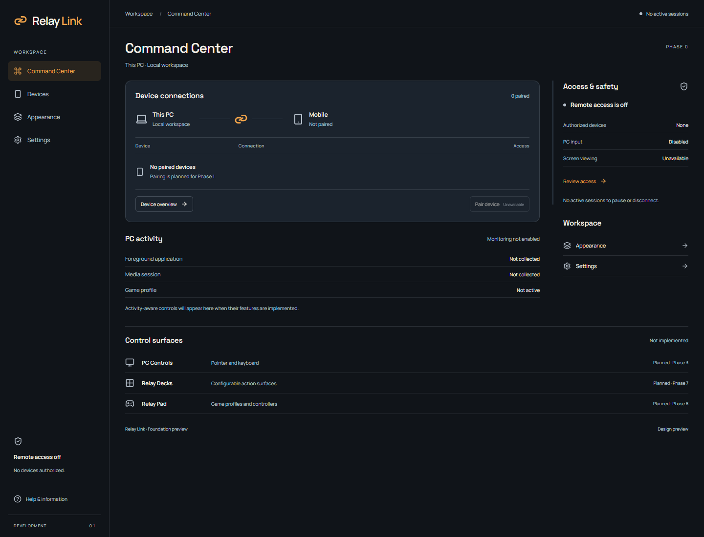
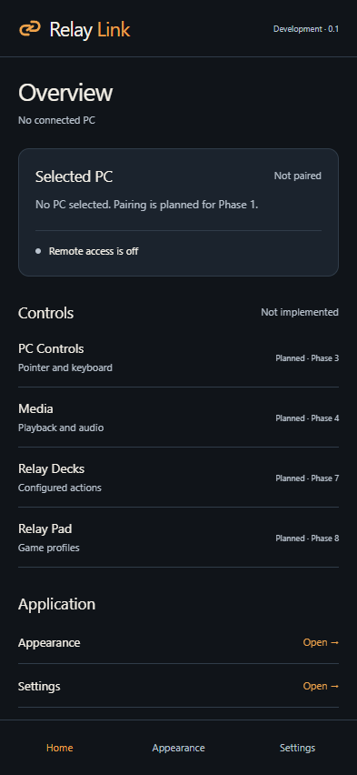
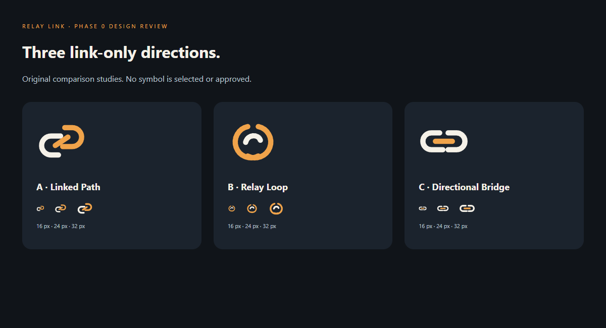
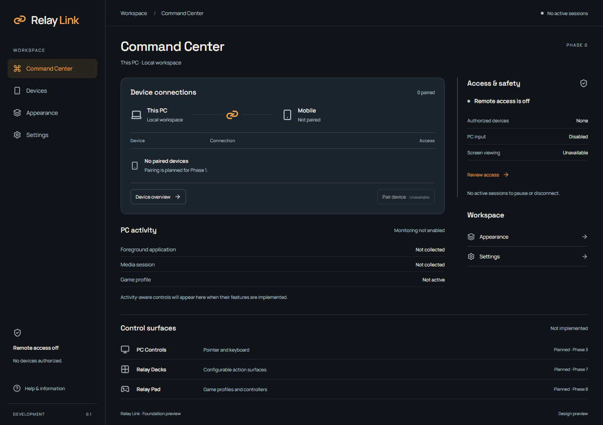
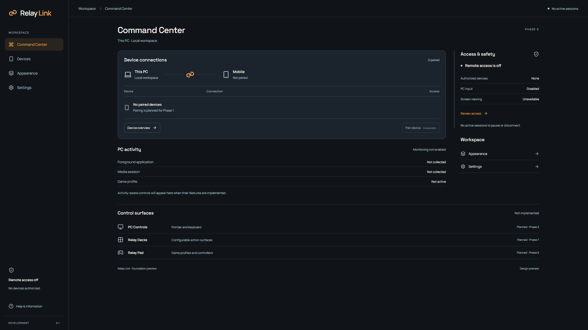
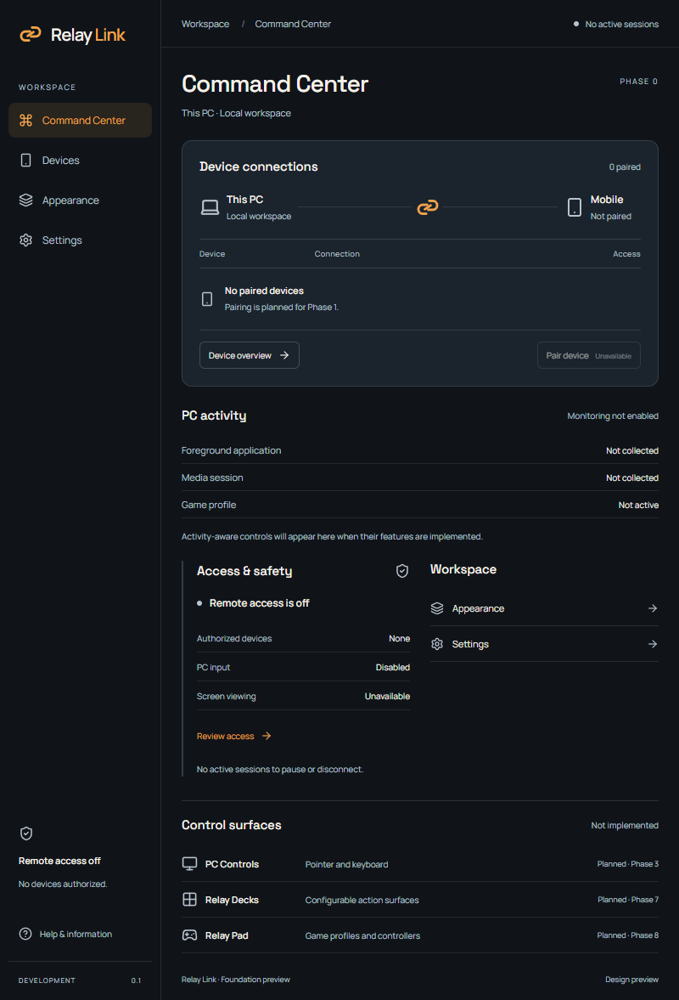
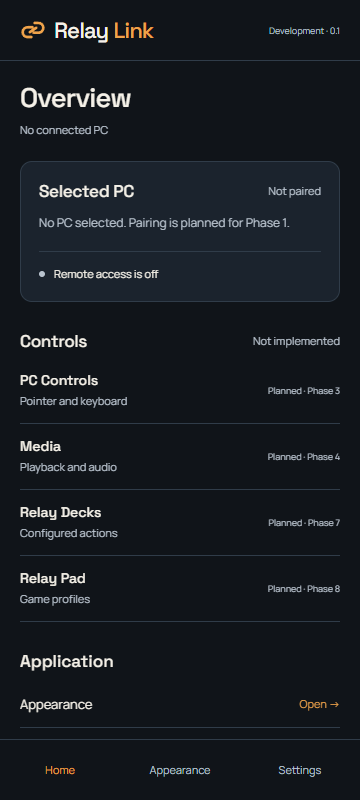
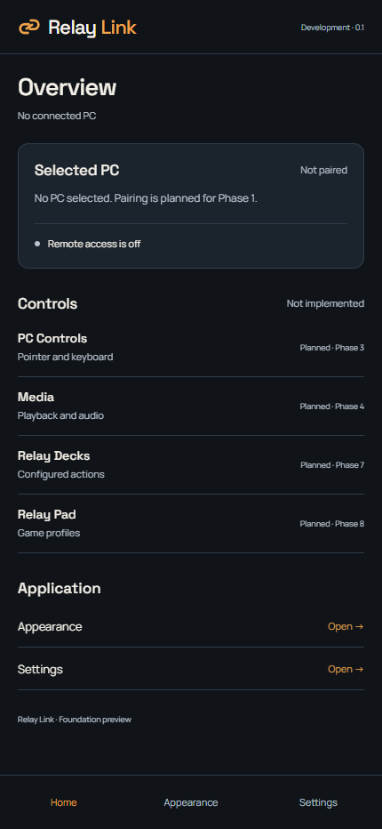
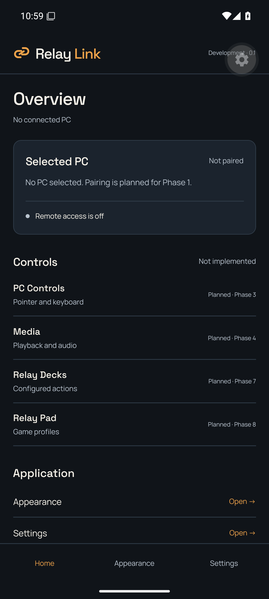
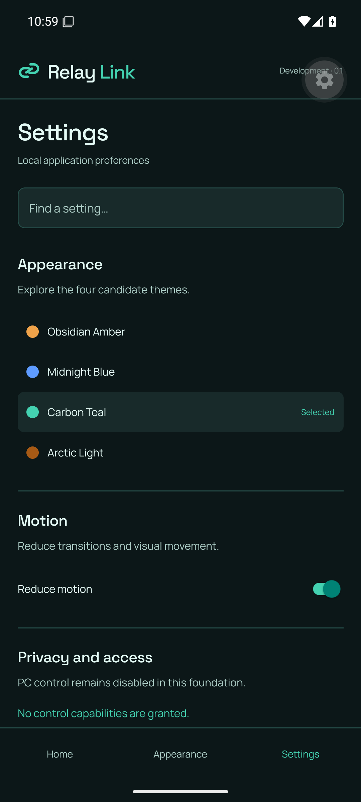

# Phase 0 foundation design review

Status: **foundation direction and A — Linked Path approved by the owner on November 4, 2026**. Final production artwork remains unapproved. These images were captured from the actual foundation shells in browser previews. Actual native Windows permission testing is separate; browser images do not establish native Android/device compatibility.

## Coordinated Desktop and Mobile direction

Candidate fonts are Space Grotesk headings and Manrope functional text. Installed font notices were inspected: both are SIL OFL 1.1; packages preserve their notices. Current weights are 400/600 UI and 500/600 display. Initial labels are English; complete language/fallback/device text-scaling coverage is not claimed. Desktop CSS includes system fallback; Android fallback must be checked on actual devices.

The signature connection hub, restrained amber/graphite surfaces, shared spacing/status vocabulary and theme families retain the approved direction. The refined Command Center uses a device workspace, activity rows, anchored access/safety state and local actions. Future control surfaces are compact planned rows, with no fabricated telemetry or active feature controls. Mobile adapts navigation/targets for touch rather than cloning Desktop. Search, local themes and reduced-motion settings work in the foundation; saved cross-device preferences and all real PC control are deferred.

The owner approved the theme/type/navigation and Linked Path foundation direction, then requested a functional application composition in place of promotional slogans, oversized feature cards and repeated containers. These captures reflect that refinement; exact production artwork and later feature screens remain reviewable at their applicable gates. See [composition allocation](APPLICATION_COMPOSITION.md).

## Three distinct letter-free link studies

- A — Linked Path: diagonal two-endpoint interlock, currently used only as a temporary development candidate.
- B — Relay Loop: rounder continuous handoff silhouette.
- C — Directional Bridge: squat horizontal connection.

The board includes native 16/24/32 px comparison. All are original studies with no letter/initial construction or supplied-art tracing. A is the owner-selected concept. Possible lookalikes, final small-size refinement and Android adaptive/monochrome production exports remain open. Temporary packaging assets do not imply final approval.

## Remaining screen and interaction studies

| Desktop / Mobile pair              | Foundation design acceptance; no later feature implementation                                                                                                     |
| ---------------------------------- | ----------------------------------------------------------------------------------------------------------------------------------------------------------------- |
| Unpaired Command Center / Home     | Name host/phone, explain access off, obvious future pairing entry, no fabricated live latency                                                                     |
| Pairing/approval/wait/expiry/error | Same identity/permission language; approve/limit/reject on host, clear recovery on phone; detailed flows remain Phase 1                                           |
| Settings / settings search         | Same concepts, local ownership, reset/conflict semantics planned, accessible non-color states                                                                     |
| Touchpad / keyboard                | Reachable essential controls, explicit disconnected/limited/paused states; real input Phase 3                                                                     |
| Shooter / profile editor           | Controls-only phone, independent left movement/right aim/actions, PC Controls, stored layout; Phase 8 mapping                                                     |
| Driving / calibration/profile      | Equal Tilt/Wheel, reachable unified Drive Control, straight versus gentle curve still undecided, deliberate reverse; actual motion Phase 10                       |
| Multi-activity / editor            | Template → Game → Activity; direct manual favorites; no fictional recognition or support                                                                          |
| Emergency loss / recovery          | Release first, one safely targeted pause attempt or clear skip, requested/observed/unknown status, fresh authentication and deliberate re-arm; gaming phases only |

This table specifies the next design comparisons; it is not a claim those detailed screens/features were implemented or visually approved. No game/sensor/driver input tests have run. Keep missing detailed visual reviews explicit in the Phase 0 result; do not declare a complete final design system from these two screenshots.

## Approval record

The owner explicitly selected “Approve foundation direction + A: Linked Path” on November 4, 2026, after reviewing this concrete comparison set. This approves the font/theme/navigation and icon concept direction for Phase 0. The subsequent functional-composition refinement supersedes the earlier slogan/card-heavy layout; it does not reopen the approved direction. B/C remain historical alternatives. Final small-size refinement/platform assets and later detailed screens remain open. This approval neither verifies compatibility nor authorizes Phase 1.

## Responsive composition verification

Executed eight Playwright/Edge smoke tests on November 4: Desktop 1280×800, 1920×1080 and compact 800×900; Mobile web 360×800 and 430×932, plus 393×852 navigation/theme/search. Captures were visually inspected. No horizontal overflow was observed; inactive pairing stays disabled, access state is visible, local access/settings navigation and theme/search/reduced-motion regressions pass. Desktop keyboard focus traversal and Mobile bottom navigation height (at least 44 px) were checked. Full-page captures include vertically scrollable content and are not all viewport-height screenshots.

These checks are evidence of the foundation composition, not a complete screen-reader, high-DPI, text-scaling or physical-device accessibility audit. The actual Windows WebView separately passed permitted local-status, denied enrolled probe, nonexistent-command and Settings smoke checks after this refinement. Native Android results are recorded in the Phase 0 verification report, not inferred from these browser captures.

## Actual Android development-build verification

The API 35 x86_64 emulator ran the development APK built on the available Windows host. Home, Settings, privacy search, Carbon Teal selection and the actual reduced-motion switch passed. The switch target was corrected from approximately 27 dp to 48 dp and measured in actual Android UI bounds; web target bounds also pass. No physical-device or full accessibility certification is implied. Expo development controls are tooling, not the planned product interface.

